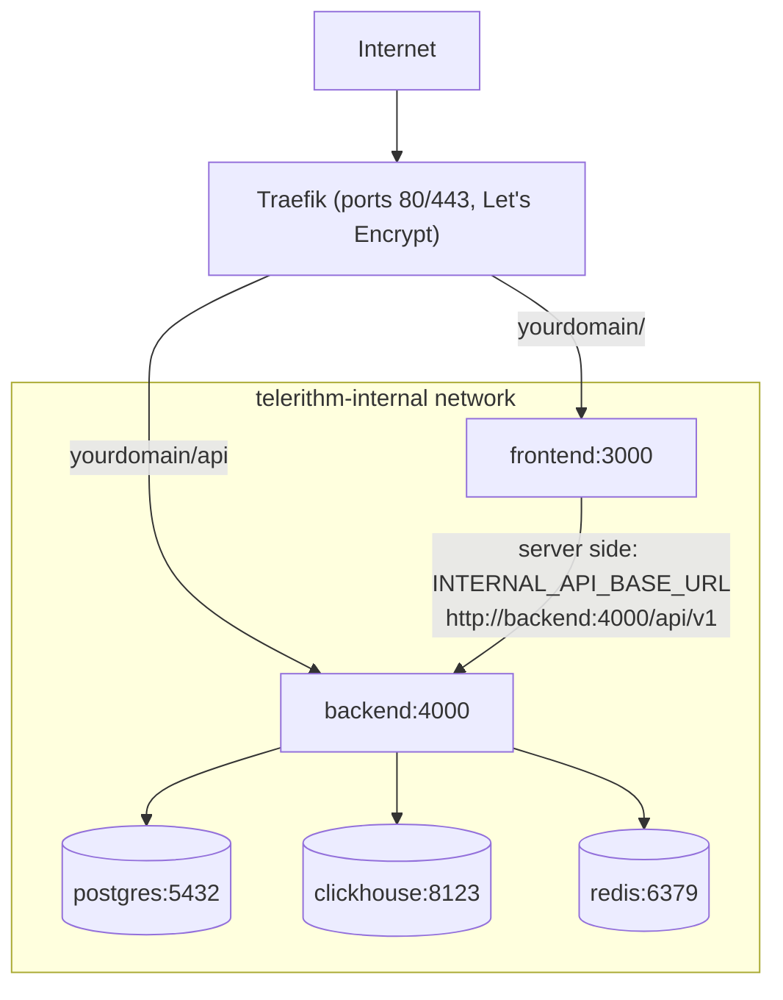

# Deployment Guide

## Prerequisites

1. **VPS with Traefik already running**
   - Docker network `traefik` exists
   - Traefik configured with Let's Encrypt cert resolver named `letsencrypt`
   - Ports 80 and 443 handled by Traefik

2. **DNS configured**
   - Your domain → A record → VPS IP

3. **Docker & Docker Compose installed**
   - Docker Engine 20.10+
   - Docker Compose v2

## Initial Setup

### 1. Clone Repository

```bash
cd /root/git
git clone https://github.com/LanNguyenSi/telerithm.git
cd telerithm
```

### 2. Create Production Environment File

```bash
cp .env.production.example .env.production
nano .env.production
```

**Required variables:**

- `POSTGRES_PASSWORD`: Strong password for PostgreSQL
- `ADMIN_EMAIL`: Email of the instance admin. With `REGISTRATION_MODE=approval` or `invite-only`, the account registered with this address is the only one that becomes active (and instance admin) without approval; without it, no account can be approved and nobody can log in. Addresses are not verified, so set your own address (not the `admin@example.com` placeholder from `.env.production.example`) and register that account right after the first start, before the instance is reachable by others.

**Optional:**

- `OPENAI_API_KEY`: Enables LLM-backed natural-language search; unset means the heuristic fallback. `docker-compose.traefik.yml` hardcodes `OPENAI_BASE_URL` to Groq (`https://api.groq.com/openai/v1`) and `OPENAI_MODEL` defaults to `openai/gpt-oss-120b`, so the key must be a Groq key. `OPENAI_MODEL` in the deploy environment overrides the model. To use another provider, edit the `OPENAI_BASE_URL` line in the backend service and set `OPENAI_MODEL` to a model of that provider. For a local LLM, see [LOCAL_LLM.md](LOCAL_LLM.md)

**Registration defaults:**

- `REGISTRATION_MODE=approval` is the recommended production default
- Use `invite-only` to disable public signup entirely
- Use `open` only for demos or trusted internal environments

Only the variables referenced in the backend `environment:` block of `docker-compose.traefik.yml` reach the container: `POSTGRES_PASSWORD`, `TRUST_PROXY`, `LOG_LEVEL`, `REGISTRATION_MODE`, `ADMIN_EMAIL`, `OPENAI_API_KEY` and `OPENAI_MODEL`. `.env.production` is only used to fill in those references. To set any other backend variable from [docs/configuration.md](docs/configuration.md) (for example `MULTI_TENANT` or `WEBHOOK_HOST_ALLOWLIST`), add a line for it to that block.

### 3. Configure Domain

Update `docker-compose.traefik.yml`, replacing every occurrence of the default domain (`demo.telerithm.cloud`) with yours:

```bash
sed -i 's/demo.telerithm.cloud/yourdomain.example/g' docker-compose.traefik.yml
```

The backend `CORS_ORIGINS` value also lists a secondary `play.telerithm.cloud` origin; edit it to match your domain(s).

This edit changes a tracked file, and `make deploy`, `make deploy-backend` and `make deploy-frontend` refuse to run while a tracked file has local changes (they never stash or discard them). Commit the edit on the server checkout (`git commit -am "Set production domain"`); the deploy targets then run `git pull --rebase origin master`, which replays that commit on top of the new upstream commits. If the rebase hits a conflict in the lines you edited, it stops and the deploy does not continue: resolve it with git, then deploy again.

`docker-compose.prod.yml` is the non-Traefik reference variant and is not what `make deploy` or the steps below use. It has its own Compose project name (`telerithm-standalone`), so running it from the production checkout does not touch the production containers or volumes; it also does not carry the production-only settings (Traefik labels, `OPENAI_*`, `TRUST_PROXY`). It takes its public URLs from two variables in `.env.production` instead of from edits to the file: `PUBLIC_API_URL` (the public API base, for example `https://telerithm.example.com/api/v1`, baked into the frontend image at build time, so rebuild the frontend after changing it) and `CORS_ORIGINS` (the browser origins the backend accepts, comma separated). Without them that file builds the frontend against `http://localhost:4000/api/v1` and accepts only `http://localhost:3000`. `docker-compose.traefik.yml` ignores both variables; it has the domain and origins written into the file, as described above.

### 4. Build & Start Services

```bash
docker compose -f docker-compose.traefik.yml --env-file .env.production up -d --build
```

This will:

- Create PostgreSQL, ClickHouse, Redis containers (internal network)
- Build backend & frontend with production configs
- Connect to Traefik for SSL/routing
- Initialize the ClickHouse schema from `backend/clickhouse/init.sql`, on the first start only (see [Updating](#updating))

### 5. Initialize Database

The backend container applies the committed Prisma migrations (`backend/prisma/migrations`) on every start, before it starts the server (`backend/entrypoint.sh` runs `backend/scripts/migrate.sh`). On a new installation the empty database gets the whole schema from them, so no manual step is required; [Database migrations](#database-migrations) describes what the step does with an existing database. The demo seed the entrypoint also invokes is skipped in production unless `SEED_DEMO_DATA=true`. Check that services are healthy:

```bash
# Wait for services to be healthy (30-60 seconds)
docker compose -f docker-compose.traefik.yml ps

# The migration step logs its decisions with the prefix "migrate:"
docker compose -f docker-compose.traefik.yml logs backend | grep 'migrate:'
```

### 6. Verify Deployment

```bash
# Check service health
docker compose -f docker-compose.traefik.yml ps

# Test endpoints
curl https://yourdomain.example/api/v1/health
curl https://yourdomain.example
```

Compose project names are fixed in the files: `docker-compose.traefik.yml` sets `name: telerithm`, which is the name the stack already had when it was cloned into a directory called `telerithm` as in step 1, so the containers, the `telerithm_telerithm-internal` network and the `telerithm_pgdata`, `telerithm_chdata` and `telerithm_redisdata` volumes keep their names. If your checkout directory has another name, your volumes carry that prefix instead; run `docker volume ls` before the first deploy of a version that sets the name, and move the data or keep the old name by adding `COMPOSE_PROJECT_NAME=<old prefix>` (for example `COMPOSE_PROJECT_NAME=myapp` for volumes called `myapp_pgdata`) to `.env.production`. Compose reads that variable from the `--env-file` and it overrides `name:` in the file; `make deploy` and `scripts/backup.sh` both pass `.env.production`, so they pick it up, while a compose command you type without `--env-file .env.production` does not and would use `telerithm`. With such an override, add `--env-file .env.production` (or `-p <old prefix>`) to every `docker compose` command in this document, or export `COMPOSE_PROJECT_NAME` in the server shell. The local `docker-compose.yml` uses `name: telerithm-dev`, so it can run on the same machine without replacing the production containers.

## Architecture

Traefik routes requests under `/api` to the backend and everything else to the frontend. Backend and frontend join both the external `traefik` network and `telerithm-internal`; the datastores join only `telerithm-internal`, and only the backend uses them. The diagram shows these connections.



**Security:**

- PostgreSQL, ClickHouse, Redis are NOT exposed to the internet
- Only backend/frontend are connected to the Traefik network
- All services communicate via internal Docker network

### Security model

- **Credentials.** Users authenticate with opaque session tokens (`sess_...`), stored in Postgres and valid for 7 days; the frontend keeps the token in an httpOnly cookie. Each log source has one API key, which is accepted only for ingest into that source (`X-API-Key` on `/api/v1/ingest/:sourceId`).
- **Roles.** The instance role (`USER` or `ADMIN`) gates the `/api/v1/admin/*` routes; only the `ADMIN_EMAIL` account gets `ADMIN` at signup, and an existing admin can grant it through `PUT /api/v1/admin/users/:id`. Team roles (`OWNER`, `ADMIN`, `MEMBER`, `VIEWER`) gate team-scoped routes and do not grant access to `/admin/*`.
- **Stored secrets.** Source API keys are stored in clear text in Postgres, so treat database backups as secrets.
- **CORS.** `CORS_ORIGINS` applies only when `NODE_ENV` is not `development`; in development the backend accepts any origin with credentials.
- **Unauthenticated endpoints.** `/metrics`, `/docs` and `/openapi.json` need no authentication. Traefik does not route them (only `/api` reaches the backend), but in this setup any container on the shared `traefik` network can reach them on the backend container's port 4000.
- **Local compose file.** `docker-compose.yml` is for local machines only: it publishes Postgres, ClickHouse and Redis on the loopback interface (`127.0.0.1`) with default or no credentials. Its project name (`telerithm-dev`) differs from the production stack's, so starting it on the server does not replace production containers, but do not run it on a host you do not trust with those ports.

## Resource Usage

Expected memory usage (8GB VPS):

| Service    | Memory           |
| ---------- | ---------------- |
| PostgreSQL | ~100MB           |
| ClickHouse | ~500MB-1GB       |
| Redis      | ~50MB            |
| Backend    | ~100MB           |
| Frontend   | ~50MB            |
| **Total**  | **~800MB-1.3GB** |

## Updating

`make deploy` does the whole update below in one command (pull, rebuild without cache and with fresh base images, recreate), `make deploy-backend` and `make deploy-frontend` do it for one service. All three stop before doing anything if a tracked file has local changes, and none of them stashes or discards a change.

A deploy through deploy-panel / agent-relay builds the pulled commit once, from the build cache (the old pre-pull `--no-cache` rebuild in `.relay.yml`'s `pre_update` built the previous commit and is gone). The cache therefore decides what a deploy contains: after a security update in the base image, or when you suspect a stale layer, run on the server after the deploy `docker compose -f docker-compose.traefik.yml --env-file .env.production build --pull --no-cache` then `docker compose -f docker-compose.traefik.yml --env-file .env.production up -d` (`--pull` fetches the newer base image; `make deploy` runs the same build, so it already does both). That is a manual step, not part of the relay flow.

A relay deploy reads a different env file than the commands above. agent-relay runs plain `docker compose -f <compose_file> build` and `docker compose -f <compose_file> up -d` in the app directory, with no `--env-file`, and its app config has no env-file option (an `env_file:` key in `.relay.yml` is not an accepted key and is silently dropped). Docker Compose therefore reads the checkout's `.env` there and never looks at `.env.production`. `make deploy` and the manual commands in this file read `.env.production` via `--env-file` instead.

Both files feed the same containers, so they must hold the same values. On a relay-managed host, treat `.env` as the file that counts: relay deploys read it, and the deploy-panel env editor and its secret provisioning write it. Keep `.env.production` as an identical copy for `make deploy` and the manual commands, and copy `.env` over it after every change made through the panel. A `.env -> .env.production` symlink does not keep them together: the env editor and secret provisioning replace `.env` with a regular file (write to a temp file, then rename), so the link is gone after the first save.

On a rebuilt host, and after an env change, validate from the checkout with `docker compose -f docker-compose.traefik.yml config --quiet` and `cmp .env .env.production`: the first must print no `variable is not set` warning (a checkout with only `.env.production` fails it on every variable the compose file references, for example `POSTGRES_PASSWORD`, because relay deploys would see them unset), the second must report no difference.

By hand (the same steps; `make deploy` additionally builds with `--pull --no-cache` and recreates the containers with `--force-recreate`, so it always picks up a changed dependency and a newer base image):

```bash
cd /root/git/telerithm
git pull --rebase origin master

# Rebuild and restart
docker compose -f docker-compose.traefik.yml --env-file .env.production build
docker compose -f docker-compose.traefik.yml --env-file .env.production up -d
```

There is no separate schema step: the new backend container applies the pending migrations before it starts the server (see [Database migrations](#database-migrations)). Back up the database before a deploy that brings a migration (`./scripts/backup.sh /backups/telerithm`, see [Backup](#backup)).

`--rebase` matters once you have committed a local edit (for example the domain in `docker-compose.traefik.yml`): a plain `git pull` fails on the diverged history, `git pull --rebase` replays your commit on top of the new master. If the rebase stops on a conflict, resolve it and run `git rebase --continue` (or `git rebase --abort`) before deploying; the deploy targets refuse to run while a rebase or merge is in progress or HEAD is detached.

Two notes for a server that deployed with an older Makefile. Older `make deploy` runs stashed local changes and never restored them, so an edit that an earlier deploy dropped may still sit in `git stash list` on the server; `git stash show -p` shows it and `git stash pop` restores it. And `make` reads the Makefile before `git pull` runs, so the first `make deploy` after this update still runs the old recipe (stash, plain pull) for that one run: commit any local edit and run `git pull --rebase origin master` yourself before it, so the old recipe has nothing left to stash and its plain pull has nothing to merge.

### Database migrations

The Postgres schema is versioned as Prisma migrations in `backend/prisma/migrations`, and `backend/prisma/schema.prisma` always equals the result of applying all of them (the CI job "Backend" applies them to an empty database and fails on any difference). Every start of the backend container runs `backend/scripts/migrate.sh` before the server. It never runs `prisma db push` and decides by the state of the database:

| Database | What the start does |
| --- | --- |
| Has a migration history (the table `public._prisma_migrations`) | `prisma migrate deploy`: applies the migrations that are not applied yet |
| Empty | `prisma migrate deploy`: the first migration, `20261027132152_baseline`, creates the whole schema |
| Has tables but no history: created by an earlier release, which applied the schema with `prisma db push` on every start | Compares the database with the frozen baseline schema `backend/prisma/baseline.prisma` (`prisma migrate diff`), the schema the baseline migration creates, not with the current `schema.prisma`. If they are equal, it records the baseline migration as applied without running it (`prisma migrate resolve --applied 20261027132152_baseline`), then runs `prisma migrate deploy`, which applies every later migration. If they differ, or `baseline.prisma` is missing, it stops (see below) |

The checks only read. When one of them fails (database unreachable, wrong password, a `DATABASE_URL` that selects a schema other than `public`), when the schema differs, or when `prisma migrate deploy` fails, the server is not started: the container exits with code 1, logs `Database migrations did not complete; the server is not started.` and restarts (`restart: unless-stopped`), and the database is left as the failed step found it.

**The first deploy of this version on an existing installation.** A database from an earlier release has tables and no history, so the first start compares it with the baseline schema (`backend/prisma/baseline.prisma`). Back up before that deploy:

```bash
./scripts/backup.sh /backups/telerithm
```

When the database matches (it does when the running release is v0.4.0 or later, started cleanly with `prisma db push`, and nobody changed the schema by hand since), the log shows

```
migrate: the database has tables but no migration history (a database from before migrations); comparing it with the baseline schema prisma/baseline.prisma.
migrate: the database matches the baseline schema prisma/baseline.prisma, recording the baseline migration 20261027132152_baseline as applied.
Migration 20261027132152_baseline marked as applied.
No pending migrations to apply.
```

and `_prisma_migrations` holds one row for `20261027132152_baseline` with `applied_steps_count` 0 (recorded, not run). Every later start finds the history (`migrate: migration history found`) and only runs `prisma migrate deploy`. An installation on a release older than v0.4.0 has an older schema, so the comparison fails: deploy v0.4.0 first (the last release that applies the schema with `prisma db push`; its `schema.prisma` is the baseline), then this version. The comparison is with `baseline.prisma`, a frozen copy of the schema the baseline migration creates (CI keeps it equal to the migration's SQL), not with the current `schema.prisma`. A later release that adds a migration therefore still baselines a database from before migrations: the start records the baseline, then `prisma migrate deploy` applies the later migrations on top. `baseline.prisma` is part of the image (the Dockerfile copies `backend/prisma/` whole), and it is never edited for a schema change.

**When the start stops because the schema differs.** The log lists the difference as the changes that would make the database match `baseline.prisma` (an extra column shows as `[-] Removed column`), followed by `migrate: the database schema differs from the baseline schema prisma/baseline.prisma` and the recovery hint. The comparison is with the baseline, not with the current `schema.prisma`, so a database that already has a later migration's change applied by hand differs too. Nothing was changed. A start with `prisma/baseline.prisma` missing stops the same way with `migrate: prisma/baseline.prisma is missing` (a broken image; rebuild it). Read it with `docker compose -f docker-compose.traefik.yml logs backend`. Under deploy-panel / agent-relay the relay's `compose up` step fails (`compose up -d` waits for the backend health check because the frontend depends on it being healthy: the step output ends in `dependency failed to start: container ... is unhealthy`, and it carries only a log excerpt of the services that were running at that moment, which can miss a backend between two restarts), and `rollback: true` redeploys the previous commit, whose entrypoint still runs `prisma db push` at start; that replaces the container and its log. To recover:

1. Back up the database: `./scripts/backup.sh /backups/telerithm`.
2. Get the difference again, as SQL, from the new release: on the server checkout at the new commit with its backend image built (after a relay rollback the checkout and the image are the previous release, so run `git pull --rebase origin master` and `docker compose -f docker-compose.traefik.yml --env-file .env.production build backend` first), run `docker compose -f docker-compose.traefik.yml --env-file .env.production run --rm --no-deps backend npx prisma migrate diff --from-schema-datasource prisma/schema.prisma --to-schema-datamodel prisma/baseline.prisma --script > fix.sql`. A one-off container is needed because the new backend container never stays up.
3. Then either make the database match the baseline: review `fix.sql` (it can drop columns and their data) and apply it with `docker compose -f docker-compose.traefik.yml exec -T postgres psql -U telerithm -d telerithm -v ON_ERROR_STOP=1 < fix.sql`. Or, when the difference is deliberate and the code works with it (an extra index, an extra nullable column), record the baseline without the check: `docker compose -f docker-compose.traefik.yml --env-file .env.production run --rm --no-deps backend npx prisma migrate resolve --applied 20261027132152_baseline`.
4. Deploy again (`make deploy-backend`, or `docker compose -f docker-compose.traefik.yml --env-file .env.production up -d backend` when the checkout is already at the new commit).

Do not repair it with `prisma db push`: it makes the database match the schema without recording a migration, and drops whatever the schema does not have.

**When a migration fails.** `prisma migrate deploy` stops with `P3018` and the error from Postgres. Its row in `_prisma_migrations` stays unfinished, and every later start stops with `P3009` until the row is resolved. What the failed migration left in the database depends on its SQL, so look before you resolve it. Postgres undoes a failed migration as a whole only when the migration has no `BEGIN`/`COMMIT` of its own (measured with a migration whose third statement failed: the table and the column its first two statements added were gone afterwards). Prisma writes its own `BEGIN`/`COMMIT` into the migration of an enum value removal (the `-- AlterEnum` block), and the statements before and inside that block stay applied when a later statement fails (measured: `CREATE TYPE` and the enum swap were committed, a later `ADD COLUMN` failed).

1. Back up the database (`./scripts/backup.sh /backups/telerithm`) and read the failed migration's SQL (`backend/prisma/migrations/<migration>/migration.sql`) against the database. The one-off container of the earlier recovery shows what is still missing: `docker compose -f docker-compose.traefik.yml --env-file .env.production run --rm --no-deps backend npx prisma migrate diff --from-schema-datasource prisma/schema.prisma --to-schema-datamodel prisma/schema.prisma --script > fix.sql`, from the image of the release whose migration failed. The file is the SQL that would make the database match `schema.prisma`; with the failed migration the last one, that is the part that did not persist (empty when the migration did apply completely).
2. Nothing persisted (the diff lists the whole migration): fix the cause, then `npx prisma migrate resolve --rolled-back <migration>`; the next start runs the migration again. Measured: a plain migration whose second statement failed left no trace, and after fixing the SQL and `--rolled-back` the next start applied it.
3. Part of it persisted: do not use `--rolled-back`, the next run would stop on the first statement that already took effect (`type "..." already exists`, measured: it loops on that error). Complete the migration by hand: review and edit `fix.sql` from step 1 (change a statement that cannot work on the existing rows; for a new `NOT NULL` column without a default in `schema.prisma`, add it as nullable, fill it with an `UPDATE`, then `SET NOT NULL`, or add it with a default and drop that default again in the same file with `ALTER COLUMN ... DROP DEFAULT`), apply it with `docker compose -f docker-compose.traefik.yml exec -T postgres psql -U telerithm -d telerithm -v ON_ERROR_STOP=1 < fix.sql`, then run the step 1 diff again and continue only when its output is empty (anything left means the database still differs from `schema.prisma`), and record the migration with `npx prisma migrate resolve --applied <migration>`. Run `--applied` from the new release's image: it needs the migration directory and stops with `P3017` in the previous release's image, which does not have it. `--rolled-back` can run from either image.
4. Deploy again. Measured with the migration Prisma generates for an enum removal plus a required column: after the hand completion with an empty re-check diff and `--applied`, the next start reported no pending migrations.

A failed migration also stops the relay rollback: the previous release's `prisma migrate deploy` meets the same unfinished row and stops with `P3009`, so its container does not come up either until the row is resolved as above (resolve it as above; after a relay rollback the checkout and the image are the previous release, so pull and build the new commit first, as in the schema-difference recovery). To keep this recovery small, put an enum value removal in a migration of its own: if that migration fails, nothing else shares its transaction boundary, and the other changes live in a migration that rolls back as a whole.

**Rollbacks do not undo migrations.** `rollback: true` in `.relay.yml` resets the code to the previous commit and redeploys it; a migration the new release applied stays applied, and the previous release then runs against the migrated schema (its `prisma migrate deploy` finds nothing to apply and leaves the migration it does not know in place). The first rollback after this version is no exception: the previous release's `prisma db push` leaves `_prisma_migrations` in place. So every migration has to keep the previous release working (expand/contract): add tables, and add columns as nullable or with a default; keep an enum value removal (Prisma's `-- AlterEnum` block, which has its own `BEGIN`/`COMMIT`) in a migration of its own; to rename or remove something, first ship the new shape together with code that no longer uses the old one, and drop the old column or table in a later release. Going back past a migration means restoring a backup.

**Changing the schema.** Edit `backend/prisma/schema.prisma`, then, with the local database from `make setup` running, create the migration in `backend/`:

```bash
npx prisma migrate dev --name add_source_description
```

It writes `prisma/migrations/<timestamp>_add_source_description/migration.sql`, applies it to the local database and regenerates the client (it creates and drops a temporary shadow database, which the local `telerithm` user may do). Review the SQL against the expand/contract rule above and commit it together with the schema change; CI fails when `schema.prisma` and the migrations disagree. `npm run db:migrate` runs the same step as the container start against the local database (`make setup` uses it). `npm run db:push` (`prisma db push`) is kept only as a shortcut for a throwaway local database: it records no migration history, so do not use it on a database that has one; a local database that has drifted can be rebuilt from the migrations with `npx prisma migrate reset` (its data is lost).

### ClickHouse schema changes

`backend/clickhouse/init.sql` runs only when the ClickHouse data directory is empty, that is on the first start of a new `chdata` volume. A deploy that changes the file does not change the running tables and does not report anything: the old schema stays in place. Apply the change by hand with an `ALTER TABLE` and keep `init.sql` in step so a fresh install gets the same schema. For example, to shorten the retention of the `logs` table to 14 days (the same statement as in [docs/architecture.md](docs/architecture.md), see the ClickHouse [ALTER TABLE reference](https://clickhouse.com/docs/sql-reference/statements/alter) for other changes):

```bash
docker compose -f docker-compose.traefik.yml exec clickhouse \
  clickhouse-client --query "ALTER TABLE logs MODIFY TTL toDateTime(timestamp) + INTERVAL 14 DAY"
```

### ClickHouse configuration changes

The files in `backend/clickhouse/config.d/` (`limits.xml`, `system-logs.xml`; `limits.xml` holds the server-wide memory ratio only) reach the running ClickHouse container on a deploy: the directory is bind-mounted over the container's `/etc/clickhouse-server/config.d`, so a file that `git pull` replaces is visible inside the container without recreating it. ClickHouse re-reads `config.d` on its own and applies server settings such as `max_server_memory_usage_to_ram_ratio` within seconds; the system log settings in `system-logs.xml` are read at server start, so after changing them restart ClickHouse once (`docker compose -f docker-compose.traefik.yml restart clickhouse`). A TTL change there only applies to newly created log tables, see [docs/okf/clickhouse-retention-and-memory-limits.md](docs/okf/clickhouse-retention-and-memory-limits.md).

The directory replaces the image's own `config.d`, so it also holds `docker_related_config.xml`, a copy of the image's file that makes the server listen on all addresses; without it the backend cannot connect to ClickHouse. When you change the ClickHouse image tag, compare it with the new image's file, and check the new image's `users.d` and entrypoint too: the image's own `users.d` is empty (checked on 24.10.2.80 and 24.12.6.70), but the entrypoint may write a file there at start (see the `users.d` paragraph below). Start the new tag once in a throwaway container with `config.d` and `users.d` mounted read-only before you move the tag in the compose files. A malformed XML file in the directory makes ClickHouse exit at start; a running server keeps its old config, so the error only shows at the next restart (host reboot, OOM, the next recreate) and the container then restarts in a loop. After a deploy that touches `config.d`, check `docker compose -f docker-compose.traefik.yml logs clickhouse` for config errors. To confirm a deploy took effect: `docker compose -f docker-compose.traefik.yml exec clickhouse ls -la /etc/clickhouse-server/config.d` lists the three files, and `exec clickhouse clickhouse-client --query "SELECT name, value FROM system.server_settings WHERE name = 'max_server_memory_usage_to_ram_ratio'"` shows the live value.

The per-query limits live in `backend/clickhouse/users.d/limits.xml`, not in `config.d`: ClickHouse reads settings profiles only from the users config (`users.xml` and `users.d`) and ignores a `<profiles>` block in `config.d`. The `default` profile there caps one query at 2 GiB (`max_memory_usage`), so a query that needs more fails with `MEMORY_LIMIT_EXCEEDED` (on 24.10 worded "Memory limit (for query) exceeded"; newer images word it differently, so match the code), and lets `GROUP BY` and `ORDER BY` spill to disk from 1 GiB (`max_bytes_before_external_group_by`, `max_bytes_before_external_sort`). The directory is mounted over `/etc/clickhouse-server/users.d` in both compose files, read-only, and a changed file is applied within seconds without a restart (new queries see it). To confirm a deploy took effect: `docker compose -f docker-compose.traefik.yml exec clickhouse clickhouse-client --query "SELECT name, value FROM system.settings WHERE name IN ('max_memory_usage', 'max_bytes_before_external_group_by', 'max_bytes_before_external_sort')"` shows `2147483648`, `1073741824` and `1073741824`; `0` means the profile is not applied.

The `clickhouse` service sets `CLICKHOUSE_SKIP_USER_SETUP: "1"` and none of `CLICKHOUSE_USER` (other than `default`), `CLICKHOUSE_PASSWORD`, `CLICKHOUSE_PASSWORD_FILE` and `CLICKHOUSE_DEFAULT_ACCESS_MANAGEMENT`; do not add any of the four. The image entrypoint can write `users.d/default-user.xml`, which fails on the read-only mount (`Read-only file system`) and the container exits at start. How often it writes depends on the image: on 24.10 (measured on 24.10.2.80, the current `:24`) only when one of the four variables is set; on newer images (measured on 24.12.6.70) on every start, even with none set, to make `default` reachable from localhost only, which would crash on the read-only mount, or break the backend's remote connection on a writable one. `CLICKHOUSE_SKIP_USER_SETUP=1` makes a newer entrypoint skip all of that (24.10 ignores the variable), so `default` stays reachable from the backend container as before. On a newer image the variable also makes the entrypoint ignore the four variables without an error, so they would silently do nothing; on 24.10 one of them stops the container at start. `scripts/clickhouse-config-guard.sh` (CI job "ClickHouse config") fails when a compose sets one of the four or drops the skip variable.

To give ClickHouse a user with a password, add files to `backend/clickhouse/users.d/`. Every file in `users.d` and `config.d` needs the `<clickhouse>` root element; without it ClickHouse exits at start (exit code 232). `users.d` is reloaded within seconds without a restart, so each step below takes effect as soon as its file is in place; follow the order, or the backend loses its connection in between.

1. Add the new user only, here in `telerithm-user.xml`, and leave `default` untouched:

   ```xml
   <clickhouse>
       <users>
           <telerithm>
               <profile>default</profile>
               <networks>
                   <ip>::/0</ip>
               </networks>
               <password_sha256_hex>PUT_THE_HASH_HERE</password_sha256_hex>
               <quota>default</quota>
           </telerithm>
       </users>
   </clickhouse>
   ```

   Get the hash without leaving the password in the shell history: `read -rs PW; printf '%s' "$PW" | sha256sum | cut -d' ' -f1` (only the first field is the hash). Check it: `docker compose -f docker-compose.traefik.yml exec clickhouse clickhouse-client --user telerithm --password "$PW" --query "SELECT getSetting('max_memory_usage')"` returns `2147483648`, so the `default` profile from `limits.xml` applies to the new user.

2. Point the backend at the new user. `CLICKHOUSE_URL` is written into `docker-compose.traefik.yml` (`http://clickhouse:8123`); change it to `http://telerithm:<password>@clickhouse:8123`, with special characters in the password percent-encoded, and commit the edit on the server checkout as described for the domain edit above (the file now holds the password in clear text, so keep the server checkout private). Recreate the backend so it picks up the new value (`docker compose -f docker-compose.traefik.yml up -d backend`) and check `GET /api/v1/health`.

3. Only then restrict `default` to connections from inside the container, in a second file such as `default-localhost.xml`:

   ```xml
   <clickhouse>
       <users>
           <default>
               <networks replace="replace">
                   <ip>127.0.0.1</ip>
                   <ip>::1</ip>
               </networks>
           </default>
       </users>
   </clickhouse>
   ```

   The compose health check and the init script on an empty data directory both connect as `default` from inside the container, so they keep working; from other containers `default` now gets `AUTHENTICATION_FAILED`. Check `docker compose -f docker-compose.traefik.yml logs clickhouse` for config errors after each step.

Do not remove `default` outright (`<default remove="remove"/>`): the health check and the init script would fail, so the container would turn unhealthy and a fresh volume would not initialise. The files were run on 24.10.2.80 and 24.12.6.70, on a fresh and on an initialised volume.

The first deploy after this layout (the compose mounts changed) recreates the ClickHouse container once; the data stays on the `chdata` volume. The first deploy that adds the `users.d` mount recreates it once more.

### Rotating the PostgreSQL password

`POSTGRES_PASSWORD` only sets the password when Postgres creates a new data volume. Changing it in `.env.production` alone does not change the database role, so the backend cannot sign in after its next restart, and the backend health check can stay green while queries fail. Change the role first, then the file:

```bash
# 1. Change the role's password. Use a password that is safe inside a URL
#    (letters and digits, for example the output of `openssl rand -hex 24`):
#    docker-compose.traefik.yml inserts it unescaped into DATABASE_URL.
docker compose -f docker-compose.traefik.yml exec postgres \
  psql -U telerithm -c "ALTER USER telerithm PASSWORD 'NEW_PASSWORD'"

# 2. Set POSTGRES_PASSWORD=NEW_PASSWORD in .env.production.

# 3. Recreate the backend so it connects with the new password.
docker compose -f docker-compose.traefik.yml --env-file .env.production \
  up -d --no-deps --force-recreate backend

# 4. Check the logs for authentication errors and sign in to the web UI;
#    do not rely on the health check alone.
docker compose -f docker-compose.traefik.yml logs --tail=50 backend
```

Connections that are already open keep working after step 1, so there is no outage between step 1 and step 3. Store the new password where your backups of `.env.production` live.

## Monitoring

```bash
# Service status
docker compose -f docker-compose.traefik.yml ps

# Logs (all or specific)
docker compose -f docker-compose.traefik.yml logs -f
docker compose -f docker-compose.traefik.yml logs -f backend

# Resource usage
docker stats
```

### Frontend health

The `frontend` service has a healthcheck, so `docker compose -f docker-compose.traefik.yml ps` shows `(healthy)` for it like for the backend. The probe asks `http://127.0.0.1:3000/` from inside the container without following the redirect and passes on any status below 400: the Next.js middleware answers `/` with a 307 to `/login` without calling the backend, so the probe says the frontend server answers, not that the backend is up (`/login` itself renders on the server with a call to the backend and answers 500 while the backend is unreachable, so it is not used as the probe). The image has no `curl` or `wget`, hence `node`. The address is `127.0.0.1`, not `localhost`: inside the container `localhost` resolves to `::1` first while Next listens on `0.0.0.0` only, so a `localhost` probe passes only through Node's network-family autoselection (measured: `node --no-network-family-autoselection` exits 1 for `localhost` and 0 for `127.0.0.1`).

- A container that is `starting` or `unhealthy` gets no traffic from Traefik: the docker provider (Traefik v2.11, `pkg/provider/docker/config.go`) skips a container whose health status is not `healthy` unless it has no healthcheck, and re-reads the routes on every `health_status` event. `demo.telerithm.cloud` answers 404 for the frontend routes (the `/api` routes belong to the backend, which has its own healthcheck) from a recreate of the frontend until its first probe succeeds. Docker Engine 25 and later probes every 5 s during the 30 s start period (measured on 29.5: healthy 5 s after the start); older engines probe first after the 30 s interval.
- Compose never restarts an unhealthy container: `restart: unless-stopped` acts on exit only. `unhealthy` takes three failed probes after the start period (measured about 90 s from the start for a frontend that never answered). The site stays dark until a probe succeeds again, which is at most one interval after a frontend that recovers on its own, or until someone restarts a frontend that does not recover (`docker compose -f docker-compose.traefik.yml restart frontend`), so alert on it.
- The relay's own deploy check hits `/api/v1/health` (the backend), so a frontend that never becomes healthy does not roll the deploy back. After a deploy check that `ps` lists the frontend as `healthy` and that the site answers.

### Prometheus metrics

The backend exposes a Prometheus scrape endpoint at `/metrics` (served at the app root, not under `/api/v1`). In this deployment the backend publishes no host port and Traefik routes only `/api` to it, so read the endpoint from inside the container:

```bash
docker compose -f docker-compose.traefik.yml exec backend \
  node -e "fetch('http://localhost:4000/metrics').then(r => r.text()).then(console.log)"
```

To scrape it, run Prometheus on a Docker network shared with the backend container (the compose project's `telerithm-internal` network; Compose prefixes the name with the project name) and target `backend:4000/metrics`. `curl http://localhost:4000/metrics` works only with the local `docker-compose.yml`.

It publishes default Node process metrics plus Telerithm series for HTTP requests (`telerithm_http_requests_total`, `telerithm_http_request_duration_ms`), ingestion (`telerithm_ingest_batches_total`, `telerithm_ingest_logs_total`), alerting (`telerithm_alert_evaluations_total`, `telerithm_alert_incidents_created_total`), SSE (`telerithm_active_sse_connections`), and NLQ (`telerithm_nlq_llm_duration_seconds`, `telerithm_nlq_llm_errors_total`, `telerithm_nlq_llm_fallback_total`, `telerithm_nlq_filter_pruned_total` for AI-generated filters dropped, by field and reason, and `telerithm_nlq_relaxed_fallback_used_total` for searches retried without AI filters after zero results).

## Backup

`scripts/backup.sh` dumps both datastores of the stack this guide deploys (`docker-compose.traefik.yml`, with `.env.production` when it exists). It exits non-zero without writing anything when that compose file is missing or its `postgres` or `clickhouse` service is not running, so a scheduled run cannot report success for a stack that is not the production one.

```bash
# Manual run
./scripts/backup.sh /backups/telerithm

# Daily at 02:00 (cron)
0 2 * * * /root/git/telerithm/scripts/backup.sh /backups/telerithm
```

Each run writes `<backup_dir>/<timestamp>/postgres.sql.gz` and `clickhouse_logs.native.gz` and keeps the latest 10 runs, at most 10 days. That cleanup only touches directories named `YYYYMMDD_HHMMSS` (not symlinks) that hold both dumps; everything else in `<backup_dir>` is left alone, with one line on stderr saying how many entries (this includes a timestamp directory without both dumps, for example one left by a killed run, which you remove by hand). An old backup that cannot be removed (permissions, a busy mount) is a warning on stderr per entry; the run goes on, runs the off-host hook for the new backup, and then exits 2 with `ERROR: retention could not remove N old backup(s); the backup is complete`, so a cron job or monitor sees that housekeeping has stopped. The new backup is kept in that case. When `rm` removed an old backup's dumps but not the rest (a locked subdirectory), only that run exits 2: the entry is no longer a complete backup, so later runs leave it alone and exit 0, and from then on only the stderr line about entries left alone shows it; remove it by hand. An old backup `rm` cannot remove at all stays complete, so every later run warns and exits 2 again until it is removed. Exit codes: 0 success, 1 any other failure (checks before the dumps, a failed dump, a failed off-host hook, any other failed top-level command, whatever its own exit status), 2 only the retention step failed; when the hook fails as well, 1 wins and the retention error line is still printed. A run that fails midway removes its own directory. Environment variables:

- `BACKUP_COMPOSE_FILE`: compose file of the stack to back up (default: `docker-compose.traefik.yml` in the repository root).
- `BACKUP_ENV_FILE`: env file passed to compose (default: `.env.production` in the repository root; skipped when it does not exist).
- `BACKUP_OFFHOST_HOOK`: path of an executable that copies the finished backup off the host. It is called with the backup directory as its only argument. Unset or empty means the backup stays on this host. A failing hook makes the script exit 1 and keeps the local backup.

A backup that stays on the server is lost with the server. Set `BACKUP_OFFHOST_HOOK` to a script that copies the directory to storage you control. The dumps contain source API keys in clear text (see Security model), so the hook should encrypt before the data leaves the host, for example:

```bash
#!/usr/bin/env bash
# /root/bin/telerithm-offsite.sh (chmod +x); $1 is the backup directory
set -euo pipefail
tar -C "$(dirname "$1")" -cz "$(basename "$1")" \
  | age -r "$AGE_RECIPIENT" \
  | ssh backup@backup-host "cat > telerithm-$(basename "$1").tar.gz.age"
```

Then run `BACKUP_OFFHOST_HOOK=/root/bin/telerithm-offsite.sh ./scripts/backup.sh /backups/telerithm` (in cron, put the variable in the crontab line or in the cron environment). The script does not run restores: test one against a scratch stack before relying on the backups.

The commands below are the manual equivalents and the restore steps. The script's ClickHouse file is gzip-compressed Native, so decompress both script files first (`gunzip -c postgres.sql.gz > backup.sql`, `gunzip -c clickhouse_logs.native.gz > logs_backup.native`).

### PostgreSQL

```bash
# Backup
docker compose -f docker-compose.traefik.yml exec postgres \
  pg_dump -U telerithm telerithm > backup_$(date +%Y%m%d).sql

# Restore
cat backup.sql | docker compose -f docker-compose.traefik.yml exec -T postgres \
  psql -U telerithm telerithm
```

### ClickHouse

Export the `logs` table in ClickHouse's Native format; this needs no server configuration:

```bash
# Backup
docker compose -f docker-compose.traefik.yml exec -T clickhouse \
  clickhouse-client --query "SELECT * FROM logs FORMAT Native" > logs_backup.native

# Restore
docker compose -f docker-compose.traefik.yml exec -T clickhouse \
  clickhouse-client --query "INSERT INTO logs FORMAT Native" < logs_backup.native
```

The shipped ClickHouse configuration (`backend/clickhouse/config.d/limits.xml`, `backend/clickhouse/config.d/system-logs.xml`, `backend/clickhouse/users.d/limits.xml`) defines no backup disk, so `BACKUP ... TO Disk(...)` is not set up. To use it, add a file that defines a backup disk and lists it under `<backups><allowed_disk>` to `backend/clickhouse/config.d/` (the directory is mounted into both `docker-compose.traefik.yml` and `docker-compose.prod.yml`, which must stay mirrored, see [docs/okf/compose-file-topology-and-drift.md](docs/okf/compose-file-topology-and-drift.md)), and keep that disk off the `chdata` volume so a backup survives the loss of the data volume.

## Maintenance

Log rows already expire after 30 days through the `logs` table TTL (`backend/clickhouse/init.sql`). Run a manual delete only for a shorter window, for example 14 days:

```bash
# Delete logs older than 14 days
docker compose -f docker-compose.traefik.yml exec clickhouse \
  clickhouse-client --query "ALTER TABLE logs DELETE WHERE timestamp < now() - INTERVAL 14 DAY"

# PostgreSQL vacuum (monthly)
docker compose -f docker-compose.traefik.yml exec postgres \
  vacuumdb -U telerithm -z telerithm
```

## Troubleshooting

| Problem                    | Solution                                                                 |
| -------------------------- | ------------------------------------------------------------------------ |
| Services won't start       | `docker compose logs` to check errors                                    |
| SSL certificate issues     | Check DNS propagation with `nslookup yourdomain`                         |
| Database connection errors | Test with `docker compose exec postgres psql -U telerithm -c "SELECT 1"` |
| Memory issues (OOM)        | Check `docker stats`, adjust limits in compose file                      |
| AI queries not working     | See [LOCAL_LLM.md](LOCAL_LLM.md) for setup                               |
