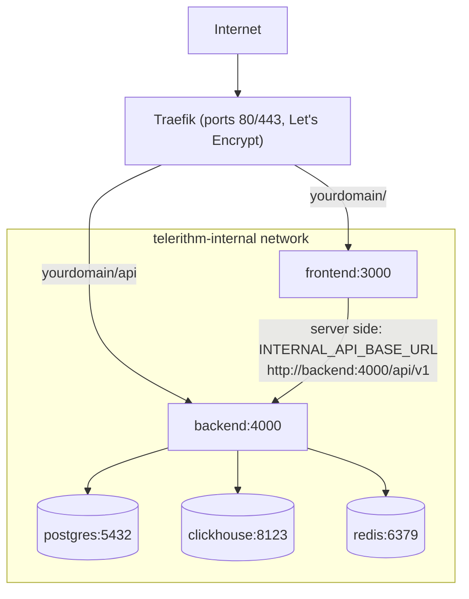

# Deployment Guide

## Prerequisites

1. **VPS with Traefik already running**
   - Docker network `traefik` exists
   - Traefik configured with Let's Encrypt cert resolver named `letsencrypt`
   - Ports 80 and 443 handled by Traefik

2. **DNS configured**
   - Your domain → A record → VPS IP

3. **Docker & Docker Compose installed**
   - Docker Engine 20.10+
   - Docker Compose v2

## Initial Setup

### 1. Clone Repository

```bash
cd /root/git
git clone https://github.com/LanNguyenSi/telerithm.git
cd telerithm
```

### 2. Create Production Environment File

```bash
cp .env.production.example .env.production
nano .env.production
```

**Required variables:**

- `POSTGRES_PASSWORD`: Strong password for PostgreSQL
- `ADMIN_EMAIL`: Email of the instance admin. With `REGISTRATION_MODE=approval` or `invite-only`, the account registered with this address is the only one that becomes active (and instance admin) without approval; without it, no account can be approved and nobody can log in. Addresses are not verified, so set your own address (not the `admin@example.com` placeholder from `.env.production.example`) and register that account right after the first start, before the instance is reachable by others.

**Optional:**

- `OPENAI_API_KEY`: Enables LLM-backed natural-language search; unset means the heuristic fallback. `docker-compose.traefik.yml` hardcodes `OPENAI_BASE_URL` to Groq (`https://api.groq.com/openai/v1`) and `OPENAI_MODEL` defaults to `openai/gpt-oss-120b`, so the key must be a Groq key. `OPENAI_MODEL` in the deploy environment overrides the model. To use another provider, edit the `OPENAI_BASE_URL` line in the backend service and set `OPENAI_MODEL` to a model of that provider. For a local LLM, see [LOCAL_LLM.md](LOCAL_LLM.md)

**Registration defaults:**

- `REGISTRATION_MODE=approval` is the recommended production default
- Use `invite-only` to disable public signup entirely
- Use `open` only for demos or trusted internal environments

Only the variables referenced in the backend `environment:` block of `docker-compose.traefik.yml` reach the container: `POSTGRES_PASSWORD`, `TRUST_PROXY`, `LOG_LEVEL`, `REGISTRATION_MODE`, `ADMIN_EMAIL`, `OPENAI_API_KEY` and `OPENAI_MODEL`. `.env.production` is only used to fill in those references. To set any other backend variable from [docs/configuration.md](docs/configuration.md) (for example `MULTI_TENANT` or `WEBHOOK_HOST_ALLOWLIST`), add a line for it to that block.

### 3. Configure Domain

Update `docker-compose.traefik.yml`, replacing every occurrence of the default domain (`demo.telerithm.cloud`) with yours:

```bash
sed -i 's/demo.telerithm.cloud/yourdomain.example/g' docker-compose.traefik.yml
```

The backend `CORS_ORIGINS` value also lists a secondary `play.telerithm.cloud` origin; edit it to match your domain(s).

### 4. Build & Start Services

```bash
docker compose -f docker-compose.traefik.yml --env-file .env.production up -d --build
```

This will:

- Create PostgreSQL, ClickHouse, Redis containers (internal network)
- Build backend & frontend with production configs
- Connect to Traefik for SSL/routing
- Initialize ClickHouse schema automatically

### 5. Initialize Database

The backend container runs `prisma db push` on every start (`backend/entrypoint.sh`), so no manual step is required. The demo seed it also invokes is skipped in production unless `SEED_DEMO_DATA=true`. Check that services are healthy, and re-sync the schema by hand only if needed:

```bash
# Wait for services to be healthy (30-60 seconds)
docker compose -f docker-compose.traefik.yml ps

# Optional: re-sync the Prisma schema manually
docker compose -f docker-compose.traefik.yml exec backend npx prisma db push
```

### 6. Verify Deployment

```bash
# Check service health
docker compose -f docker-compose.traefik.yml ps

# Test endpoints
curl https://yourdomain.example/api/v1/health
curl https://yourdomain.example
```

## Architecture

Traefik routes requests under `/api` to the backend and everything else to the frontend. Backend and frontend join both the external `traefik` network and `telerithm-internal`; the datastores join only `telerithm-internal`, and only the backend uses them. The diagram shows these connections.



**Security:**

- PostgreSQL, ClickHouse, Redis are NOT exposed to the internet
- Only backend/frontend are connected to the Traefik network
- All services communicate via internal Docker network

### Security model

- **Credentials.** Users authenticate with opaque session tokens (`sess_...`), stored in Postgres and valid for 7 days; the frontend keeps the token in an httpOnly cookie. Each log source has one API key, which is accepted only for ingest into that source (`X-API-Key` on `/api/v1/ingest/:sourceId`).
- **Roles.** The instance role (`USER` or `ADMIN`) gates the `/api/v1/admin/*` routes; only the `ADMIN_EMAIL` account gets `ADMIN` at signup, and an existing admin can grant it through `PUT /api/v1/admin/users/:id`. Team roles (`OWNER`, `ADMIN`, `MEMBER`, `VIEWER`) gate team-scoped routes and do not grant access to `/admin/*`.
- **Stored secrets.** Source API keys are stored in clear text in Postgres, so treat database backups as secrets.
- **CORS.** `CORS_ORIGINS` applies only when `NODE_ENV` is not `development`; in development the backend accepts any origin with credentials.
- **Unauthenticated endpoints.** `/metrics`, `/docs` and `/openapi.json` need no authentication. Traefik does not route them (only `/api` reaches the backend), but in this setup any container on the shared `traefik` network can reach them on the backend container's port 4000.
- **Local compose file.** `docker-compose.yml` is for local machines only: it publishes Postgres, ClickHouse and Redis on host ports with default or no credentials.

## Resource Usage

Expected memory usage (8GB VPS):

| Service    | Memory           |
| ---------- | ---------------- |
| PostgreSQL | ~100MB           |
| ClickHouse | ~500MB-1GB       |
| Redis      | ~50MB            |
| Backend    | ~100MB           |
| Frontend   | ~50MB            |
| **Total**  | **~800MB-1.3GB** |

## Updating

```bash
cd /root/git/telerithm
git pull origin master

# Rebuild and restart
docker compose -f docker-compose.traefik.yml --env-file .env.production build
docker compose -f docker-compose.traefik.yml --env-file .env.production up -d

# Apply schema changes (prisma db push)
docker compose -f docker-compose.traefik.yml exec backend npx prisma db push
```

## Monitoring

```bash
# Service status
docker compose -f docker-compose.traefik.yml ps

# Logs (all or specific)
docker compose -f docker-compose.traefik.yml logs -f
docker compose -f docker-compose.traefik.yml logs -f backend

# Resource usage
docker stats
```

### Prometheus metrics

The backend exposes a Prometheus scrape endpoint at `/metrics` (served at the app root, not under `/api/v1`). In this deployment the backend publishes no host port and Traefik routes only `/api` to it, so read the endpoint from inside the container:

```bash
docker compose -f docker-compose.traefik.yml exec backend \
  node -e "fetch('http://localhost:4000/metrics').then(r => r.text()).then(console.log)"
```

To scrape it, run Prometheus on a Docker network shared with the backend container (the compose project's `telerithm-internal` network; Compose prefixes the name with the project name) and target `backend:4000/metrics`. `curl http://localhost:4000/metrics` works only with the local `docker-compose.yml`.

It publishes default Node process metrics plus Telerithm series for HTTP requests (`telerithm_http_requests_total`, `telerithm_http_request_duration_ms`), ingestion (`telerithm_ingest_batches_total`, `telerithm_ingest_logs_total`), alerting (`telerithm_alert_evaluations_total`, `telerithm_alert_incidents_created_total`), SSE (`telerithm_active_sse_connections`), and NLQ (`telerithm_nlq_llm_duration_seconds`, `telerithm_nlq_llm_errors_total`, `telerithm_nlq_llm_fallback_total`, `telerithm_nlq_filter_pruned_total` for AI-generated filters dropped, by field and reason, and `telerithm_nlq_relaxed_fallback_used_total` for searches retried without AI filters after zero results).

## Backup

### PostgreSQL

```bash
# Backup
docker compose -f docker-compose.traefik.yml exec postgres \
  pg_dump -U telerithm telerithm > backup_$(date +%Y%m%d).sql

# Restore
cat backup.sql | docker compose -f docker-compose.traefik.yml exec -T postgres \
  psql -U telerithm telerithm
```

### ClickHouse

Export the `logs` table in ClickHouse's Native format; this needs no server configuration:

```bash
# Backup
docker compose -f docker-compose.traefik.yml exec -T clickhouse \
  clickhouse-client --query "SELECT * FROM logs FORMAT Native" > logs_backup.native

# Restore
docker compose -f docker-compose.traefik.yml exec -T clickhouse \
  clickhouse-client --query "INSERT INTO logs FORMAT Native" < logs_backup.native
```

The shipped ClickHouse configuration (`backend/clickhouse/limits.xml`, `backend/clickhouse/system-logs.xml`) defines no backup disk, so `BACKUP ... TO Disk(...)` is not set up. To use it, add a `config.d` file that defines a backup disk and lists it under `<backups><allowed_disk>`, mount it in both `docker-compose.traefik.yml` and `docker-compose.prod.yml` (they must stay mirrored, see [docs/okf/compose-file-topology-and-drift.md](docs/okf/compose-file-topology-and-drift.md)), and keep that disk off the `chdata` volume so a backup survives the loss of the data volume.

## Maintenance

Log rows already expire after 30 days through the `logs` table TTL (`backend/clickhouse/init.sql`). Run a manual delete only for a shorter window, for example 14 days:

```bash
# Delete logs older than 14 days
docker compose -f docker-compose.traefik.yml exec clickhouse \
  clickhouse-client --query "ALTER TABLE logs DELETE WHERE timestamp < now() - INTERVAL 14 DAY"

# PostgreSQL vacuum (monthly)
docker compose -f docker-compose.traefik.yml exec postgres \
  vacuumdb -U telerithm -z telerithm
```

## Troubleshooting

| Problem                    | Solution                                                                 |
| -------------------------- | ------------------------------------------------------------------------ |
| Services won't start       | `docker compose logs` to check errors                                    |
| SSL certificate issues     | Check DNS propagation with `nslookup yourdomain`                         |
| Database connection errors | Test with `docker compose exec postgres psql -U telerithm -c "SELECT 1"` |
| Memory issues (OOM)        | Check `docker stats`, adjust limits in compose file                      |
| AI queries not working     | See [LOCAL_LLM.md](LOCAL_LLM.md) for setup                               |
