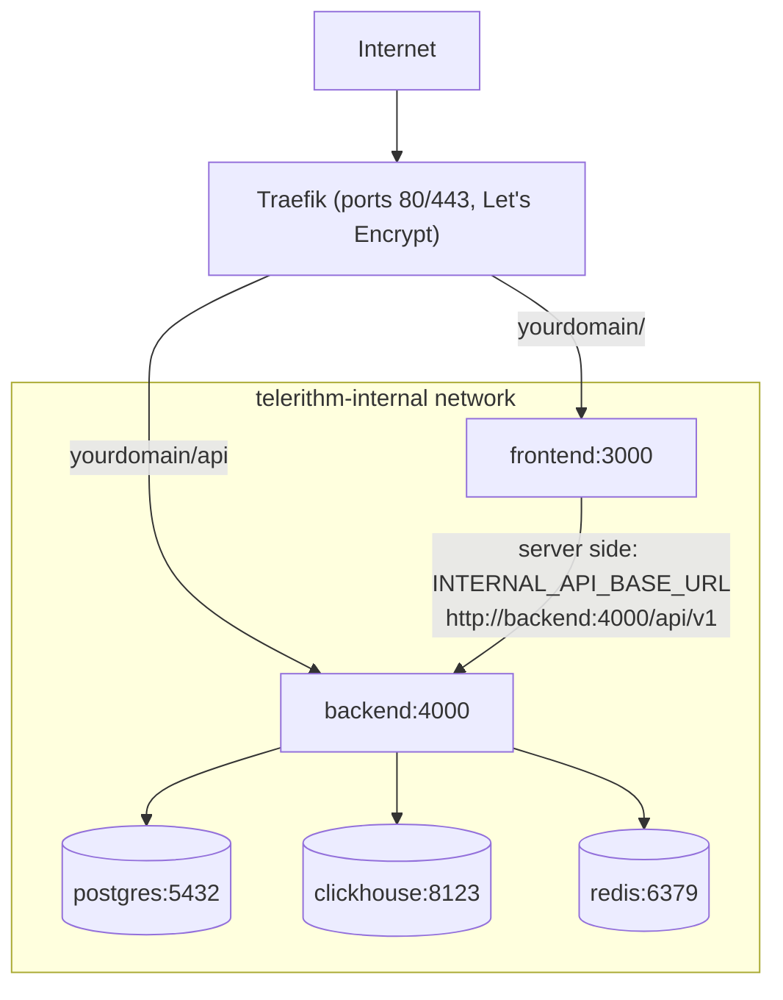

# Deployment Guide

## Prerequisites

1. **VPS with Traefik already running**
   - Docker network `traefik` exists
   - Traefik configured with Let's Encrypt cert resolver named `letsencrypt`
   - Ports 80 and 443 handled by Traefik

2. **DNS configured**
   - Your domain → A record → VPS IP

3. **Docker & Docker Compose installed**
   - Docker Engine 20.10+
   - Docker Compose v2

## Initial Setup

### 1. Clone Repository

```bash
cd /root/git
git clone https://github.com/LanNguyenSi/telerithm.git
cd telerithm
```

### 2. Create Production Environment File

```bash
cp .env.production.example .env.production
nano .env.production
```

**Required variables:**

- `POSTGRES_PASSWORD`: Strong password for PostgreSQL
- `ADMIN_EMAIL`: Email of the instance admin. With `REGISTRATION_MODE=approval` or `invite-only`, the account registered with this address is the only one that becomes active (and instance admin) without approval; without it, no account can be approved and nobody can log in. Addresses are not verified, so set your own address (not the `admin@example.com` placeholder from `.env.production.example`) and register that account right after the first start, before the instance is reachable by others.

**Optional:**

- `OPENAI_API_KEY`: Enables LLM-backed natural-language search; unset means the heuristic fallback. `docker-compose.traefik.yml` hardcodes `OPENAI_BASE_URL` to Groq (`https://api.groq.com/openai/v1`) and `OPENAI_MODEL` defaults to `openai/gpt-oss-120b`, so the key must be a Groq key. `OPENAI_MODEL` in the deploy environment overrides the model. To use another provider, edit the `OPENAI_BASE_URL` line in the backend service and set `OPENAI_MODEL` to a model of that provider. For a local LLM, see [LOCAL_LLM.md](LOCAL_LLM.md)

**Registration defaults:**

- `REGISTRATION_MODE=approval` is the recommended production default
- Use `invite-only` to disable public signup entirely
- Use `open` only for demos or trusted internal environments

Only the variables referenced in the backend `environment:` block of `docker-compose.traefik.yml` reach the container: `POSTGRES_PASSWORD`, `TRUST_PROXY`, `LOG_LEVEL`, `REGISTRATION_MODE`, `ADMIN_EMAIL`, `OPENAI_API_KEY` and `OPENAI_MODEL`. `.env.production` is only used to fill in those references. To set any other backend variable from [docs/configuration.md](docs/configuration.md) (for example `MULTI_TENANT` or `WEBHOOK_HOST_ALLOWLIST`), add a line for it to that block.

### 3. Configure Domain

Update `docker-compose.traefik.yml`, replacing every occurrence of the default domain (`demo.telerithm.cloud`) with yours:

```bash
sed -i 's/demo.telerithm.cloud/yourdomain.example/g' docker-compose.traefik.yml
```

The backend `CORS_ORIGINS` value also lists a secondary `play.telerithm.cloud` origin; edit it to match your domain(s).

This edit changes a tracked file, and `make deploy`, `make deploy-backend` and `make deploy-frontend` refuse to run while a tracked file has local changes (they never stash or discard them). Commit the edit on the server checkout (`git commit -am "Set production domain"`); the deploy targets then run `git pull --rebase origin master`, which replays that commit on top of the new upstream commits. If the rebase hits a conflict in the lines you edited, it stops and the deploy does not continue: resolve it with git, then deploy again.

`docker-compose.prod.yml` is the non-Traefik reference variant and is not what `make deploy` or the steps below use. It takes its public URLs from two variables in `.env.production` instead of from edits to the file: `PUBLIC_API_URL` (the public API base, for example `https://telerithm.example.com/api/v1`, baked into the frontend image at build time, so rebuild the frontend after changing it) and `CORS_ORIGINS` (the browser origins the backend accepts, comma separated). Without them that file builds the frontend against `http://localhost:4000/api/v1` and accepts only `http://localhost:3000`. `docker-compose.traefik.yml` ignores both variables; it has the domain and origins written into the file, as described above.

### 4. Build & Start Services

```bash
docker compose -f docker-compose.traefik.yml --env-file .env.production up -d --build
```

This will:

- Create PostgreSQL, ClickHouse, Redis containers (internal network)
- Build backend & frontend with production configs
- Connect to Traefik for SSL/routing
- Initialize the ClickHouse schema from `backend/clickhouse/init.sql`, on the first start only (see [Updating](#updating))

### 5. Initialize Database

The backend container runs `prisma db push` on every start (`backend/entrypoint.sh`), so no manual step is required. The demo seed it also invokes is skipped in production unless `SEED_DEMO_DATA=true`. Check that services are healthy, and re-sync the schema by hand only if needed:

```bash
# Wait for services to be healthy (30-60 seconds)
docker compose -f docker-compose.traefik.yml ps

# Optional: re-sync the Prisma schema manually
docker compose -f docker-compose.traefik.yml exec backend npx prisma db push
```

### 6. Verify Deployment

```bash
# Check service health
docker compose -f docker-compose.traefik.yml ps

# Test endpoints
curl https://yourdomain.example/api/v1/health
curl https://yourdomain.example
```

Compose project names are fixed in the files: `docker-compose.traefik.yml` sets `name: telerithm`, which is the name the stack already had when it was cloned into a directory called `telerithm` as in step 1, so the containers, the `telerithm_telerithm-internal` network and the `telerithm_pgdata`, `telerithm_chdata` and `telerithm_redisdata` volumes keep their names. If your checkout directory has another name, your volumes carry that prefix instead; run `docker volume ls` before the first deploy of a version that sets the name, and move the data or keep the old name by adding `COMPOSE_PROJECT_NAME=<old prefix>` (for example `COMPOSE_PROJECT_NAME=myapp` for volumes called `myapp_pgdata`) to `.env.production`. Compose reads that variable from the `--env-file` and it overrides `name:` in the file; `make deploy` and `scripts/backup.sh` both pass `.env.production`, so they pick it up, while a compose command you type without `--env-file .env.production` does not and would use `telerithm`. With such an override, add `--env-file .env.production` (or `-p <old prefix>`) to every `docker compose` command in this document, or export `COMPOSE_PROJECT_NAME` in the server shell. The local `docker-compose.yml` uses `name: telerithm-dev`, so it can run on the same machine without replacing the production containers.

## Architecture

Traefik routes requests under `/api` to the backend and everything else to the frontend. Backend and frontend join both the external `traefik` network and `telerithm-internal`; the datastores join only `telerithm-internal`, and only the backend uses them. The diagram shows these connections.



**Security:**

- PostgreSQL, ClickHouse, Redis are NOT exposed to the internet
- Only backend/frontend are connected to the Traefik network
- All services communicate via internal Docker network

### Security model

- **Credentials.** Users authenticate with opaque session tokens (`sess_...`), stored in Postgres and valid for 7 days; the frontend keeps the token in an httpOnly cookie. Each log source has one API key, which is accepted only for ingest into that source (`X-API-Key` on `/api/v1/ingest/:sourceId`).
- **Roles.** The instance role (`USER` or `ADMIN`) gates the `/api/v1/admin/*` routes; only the `ADMIN_EMAIL` account gets `ADMIN` at signup, and an existing admin can grant it through `PUT /api/v1/admin/users/:id`. Team roles (`OWNER`, `ADMIN`, `MEMBER`, `VIEWER`) gate team-scoped routes and do not grant access to `/admin/*`.
- **Stored secrets.** Source API keys are stored in clear text in Postgres, so treat database backups as secrets.
- **CORS.** `CORS_ORIGINS` applies only when `NODE_ENV` is not `development`; in development the backend accepts any origin with credentials.
- **Unauthenticated endpoints.** `/metrics`, `/docs` and `/openapi.json` need no authentication. Traefik does not route them (only `/api` reaches the backend), but in this setup any container on the shared `traefik` network can reach them on the backend container's port 4000.
- **Local compose file.** `docker-compose.yml` is for local machines only: it publishes Postgres, ClickHouse and Redis on the loopback interface (`127.0.0.1`) with default or no credentials. Its project name (`telerithm-dev`) differs from the production stack's, so starting it on the server does not replace production containers, but do not run it on a host you do not trust with those ports.

## Resource Usage

Expected memory usage (8GB VPS):

| Service    | Memory           |
| ---------- | ---------------- |
| PostgreSQL | ~100MB           |
| ClickHouse | ~500MB-1GB       |
| Redis      | ~50MB            |
| Backend    | ~100MB           |
| Frontend   | ~50MB            |
| **Total**  | **~800MB-1.3GB** |

## Updating

`make deploy` does the whole update below in one command (pull, rebuild without cache, recreate), `make deploy-backend` and `make deploy-frontend` do it for one service. All three stop before doing anything if a tracked file has local changes, and none of them stashes or discards a change.

By hand (the same steps; `make deploy` additionally builds with `--no-cache` and recreates the containers with `--force-recreate`, so it always picks up a changed base image or dependency):

```bash
cd /root/git/telerithm
git pull --rebase origin master

# Rebuild and restart
docker compose -f docker-compose.traefik.yml --env-file .env.production build
docker compose -f docker-compose.traefik.yml --env-file .env.production up -d

# Apply schema changes (prisma db push)
docker compose -f docker-compose.traefik.yml exec backend npx prisma db push
```

`--rebase` matters once you have committed a local edit (for example the domain in `docker-compose.traefik.yml`): a plain `git pull` fails on the diverged history, `git pull --rebase` replays your commit on top of the new master. If the rebase stops on a conflict, resolve it and run `git rebase --continue` (or `git rebase --abort`) before deploying; the deploy targets refuse to run while a rebase or merge is in progress or HEAD is detached.

Two notes for a server that deployed with an older Makefile. Older `make deploy` runs stashed local changes and never restored them, so an edit that an earlier deploy dropped may still sit in `git stash list` on the server; `git stash show -p` shows it and `git stash pop` restores it. And `make` reads the Makefile before `git pull` runs, so the first `make deploy` after this update still runs the old recipe (stash, plain pull) for that one run: commit any local edit and run `git pull --rebase origin master` yourself before it, so the old recipe has nothing left to stash and its plain pull has nothing to merge.

### ClickHouse schema changes

`backend/clickhouse/init.sql` runs only when the ClickHouse data directory is empty, that is on the first start of a new `chdata` volume. A deploy that changes the file does not change the running tables and does not report anything: the old schema stays in place. Apply the change by hand with an `ALTER TABLE` and keep `init.sql` in step so a fresh install gets the same schema. For example, to shorten the retention of the `logs` table to 14 days (the same statement as in [docs/architecture.md](docs/architecture.md), see the ClickHouse [ALTER TABLE reference](https://clickhouse.com/docs/sql-reference/statements/alter) for other changes):

```bash
docker compose -f docker-compose.traefik.yml exec clickhouse \
  clickhouse-client --query "ALTER TABLE logs MODIFY TTL toDateTime(timestamp) + INTERVAL 14 DAY"
```

### ClickHouse configuration changes

The files in `backend/clickhouse/config.d/` (`limits.xml`, `system-logs.xml`) reach the running ClickHouse container on a deploy: the directory is bind-mounted over the container's `/etc/clickhouse-server/config.d`, so a file that `git pull` replaces is visible inside the container without recreating it. ClickHouse re-reads `config.d` on its own and applies server settings such as `max_server_memory_usage_to_ram_ratio` within seconds; the system log settings in `system-logs.xml` are read at server start, so after changing them restart ClickHouse once (`docker compose -f docker-compose.traefik.yml restart clickhouse`). A TTL change there only applies to newly created log tables, see [docs/okf/clickhouse-retention-and-memory-limits.md](docs/okf/clickhouse-retention-and-memory-limits.md).

The directory replaces the image's own `config.d`, so it also holds `docker_related_config.xml`, a copy of the image's file that makes the server listen on all addresses; without it the backend cannot connect to ClickHouse. Compare it with the new image's file when you change the ClickHouse image tag. A malformed XML file in the directory makes ClickHouse exit at start. To confirm a deploy took effect: `docker compose -f docker-compose.traefik.yml exec clickhouse ls -la /etc/clickhouse-server/config.d` lists the three files, and `exec clickhouse clickhouse-client --query "SELECT name, value FROM system.server_settings WHERE name = 'max_server_memory_usage_to_ram_ratio'"` shows the live value.

The first deploy after this layout (the compose mounts changed) recreates the ClickHouse container once; the data stays on the `chdata` volume.

### Rotating the PostgreSQL password

`POSTGRES_PASSWORD` only sets the password when Postgres creates a new data volume. Changing it in `.env.production` alone does not change the database role, so the backend cannot sign in after its next restart, and the backend health check can stay green while queries fail. Change the role first, then the file:

```bash
# 1. Change the role's password. Use a password that is safe inside a URL
#    (letters and digits, for example the output of `openssl rand -hex 24`):
#    docker-compose.traefik.yml inserts it unescaped into DATABASE_URL.
docker compose -f docker-compose.traefik.yml exec postgres \
  psql -U telerithm -c "ALTER USER telerithm PASSWORD 'NEW_PASSWORD'"

# 2. Set POSTGRES_PASSWORD=NEW_PASSWORD in .env.production.

# 3. Recreate the backend so it connects with the new password.
docker compose -f docker-compose.traefik.yml --env-file .env.production \
  up -d --no-deps --force-recreate backend

# 4. Check the logs for authentication errors and sign in to the web UI;
#    do not rely on the health check alone.
docker compose -f docker-compose.traefik.yml logs --tail=50 backend
```

Connections that are already open keep working after step 1, so there is no outage between step 1 and step 3. Store the new password where your backups of `.env.production` live.

## Monitoring

```bash
# Service status
docker compose -f docker-compose.traefik.yml ps

# Logs (all or specific)
docker compose -f docker-compose.traefik.yml logs -f
docker compose -f docker-compose.traefik.yml logs -f backend

# Resource usage
docker stats
```

### Prometheus metrics

The backend exposes a Prometheus scrape endpoint at `/metrics` (served at the app root, not under `/api/v1`). In this deployment the backend publishes no host port and Traefik routes only `/api` to it, so read the endpoint from inside the container:

```bash
docker compose -f docker-compose.traefik.yml exec backend \
  node -e "fetch('http://localhost:4000/metrics').then(r => r.text()).then(console.log)"
```

To scrape it, run Prometheus on a Docker network shared with the backend container (the compose project's `telerithm-internal` network; Compose prefixes the name with the project name) and target `backend:4000/metrics`. `curl http://localhost:4000/metrics` works only with the local `docker-compose.yml`.

It publishes default Node process metrics plus Telerithm series for HTTP requests (`telerithm_http_requests_total`, `telerithm_http_request_duration_ms`), ingestion (`telerithm_ingest_batches_total`, `telerithm_ingest_logs_total`), alerting (`telerithm_alert_evaluations_total`, `telerithm_alert_incidents_created_total`), SSE (`telerithm_active_sse_connections`), and NLQ (`telerithm_nlq_llm_duration_seconds`, `telerithm_nlq_llm_errors_total`, `telerithm_nlq_llm_fallback_total`, `telerithm_nlq_filter_pruned_total` for AI-generated filters dropped, by field and reason, and `telerithm_nlq_relaxed_fallback_used_total` for searches retried without AI filters after zero results).

## Backup

`scripts/backup.sh` dumps both datastores of the stack this guide deploys (`docker-compose.traefik.yml`, with `.env.production` when it exists). It exits non-zero without writing anything when that compose file is missing or its `postgres` or `clickhouse` service is not running, so a scheduled run cannot report success for a stack that is not the production one.

```bash
# Manual run
./scripts/backup.sh /backups/telerithm

# Daily at 02:00 (cron)
0 2 * * * /root/git/telerithm/scripts/backup.sh /backups/telerithm
```

Each run writes `<backup_dir>/<timestamp>/postgres.sql.gz` and `clickhouse_logs.native.gz` and keeps the latest 10 runs, at most 10 days. A run that fails midway removes its own directory. Environment variables:

- `BACKUP_COMPOSE_FILE`: compose file of the stack to back up (default: `docker-compose.traefik.yml` in the repository root).
- `BACKUP_ENV_FILE`: env file passed to compose (default: `.env.production` in the repository root; skipped when it does not exist).
- `BACKUP_OFFHOST_HOOK`: path of an executable that copies the finished backup off the host. It is called with the backup directory as its only argument. Unset or empty means the backup stays on this host. A failing hook makes the script exit non-zero and keeps the local backup.

A backup that stays on the server is lost with the server. Set `BACKUP_OFFHOST_HOOK` to a script that copies the directory to storage you control. The dumps contain source API keys in clear text (see Security model), so the hook should encrypt before the data leaves the host, for example:

```bash
#!/usr/bin/env bash
# /root/bin/telerithm-offsite.sh (chmod +x); $1 is the backup directory
set -euo pipefail
tar -C "$(dirname "$1")" -cz "$(basename "$1")" \
  | age -r "$AGE_RECIPIENT" \
  | ssh backup@backup-host "cat > telerithm-$(basename "$1").tar.gz.age"
```

Then run `BACKUP_OFFHOST_HOOK=/root/bin/telerithm-offsite.sh ./scripts/backup.sh /backups/telerithm` (in cron, put the variable in the crontab line or in the cron environment). The script does not run restores: test one against a scratch stack before relying on the backups.

The commands below are the manual equivalents and the restore steps. The script's ClickHouse file is gzip-compressed Native, so decompress both script files first (`gunzip -c postgres.sql.gz > backup.sql`, `gunzip -c clickhouse_logs.native.gz > logs_backup.native`).

### PostgreSQL

```bash
# Backup
docker compose -f docker-compose.traefik.yml exec postgres \
  pg_dump -U telerithm telerithm > backup_$(date +%Y%m%d).sql

# Restore
cat backup.sql | docker compose -f docker-compose.traefik.yml exec -T postgres \
  psql -U telerithm telerithm
```

### ClickHouse

Export the `logs` table in ClickHouse's Native format; this needs no server configuration:

```bash
# Backup
docker compose -f docker-compose.traefik.yml exec -T clickhouse \
  clickhouse-client --query "SELECT * FROM logs FORMAT Native" > logs_backup.native

# Restore
docker compose -f docker-compose.traefik.yml exec -T clickhouse \
  clickhouse-client --query "INSERT INTO logs FORMAT Native" < logs_backup.native
```

The shipped ClickHouse configuration (`backend/clickhouse/config.d/limits.xml`, `backend/clickhouse/config.d/system-logs.xml`) defines no backup disk, so `BACKUP ... TO Disk(...)` is not set up. To use it, add a file that defines a backup disk and lists it under `<backups><allowed_disk>` to `backend/clickhouse/config.d/` (the directory is mounted into both `docker-compose.traefik.yml` and `docker-compose.prod.yml`, which must stay mirrored, see [docs/okf/compose-file-topology-and-drift.md](docs/okf/compose-file-topology-and-drift.md)), and keep that disk off the `chdata` volume so a backup survives the loss of the data volume.

## Maintenance

Log rows already expire after 30 days through the `logs` table TTL (`backend/clickhouse/init.sql`). Run a manual delete only for a shorter window, for example 14 days:

```bash
# Delete logs older than 14 days
docker compose -f docker-compose.traefik.yml exec clickhouse \
  clickhouse-client --query "ALTER TABLE logs DELETE WHERE timestamp < now() - INTERVAL 14 DAY"

# PostgreSQL vacuum (monthly)
docker compose -f docker-compose.traefik.yml exec postgres \
  vacuumdb -U telerithm -z telerithm
```

## Troubleshooting

| Problem                    | Solution                                                                 |
| -------------------------- | ------------------------------------------------------------------------ |
| Services won't start       | `docker compose logs` to check errors                                    |
| SSL certificate issues     | Check DNS propagation with `nslookup yourdomain`                         |
| Database connection errors | Test with `docker compose exec postgres psql -U telerithm -c "SELECT 1"` |
| Memory issues (OOM)        | Check `docker stats`, adjust limits in compose file                      |
| AI queries not working     | See [LOCAL_LLM.md](LOCAL_LLM.md) for setup                               |
