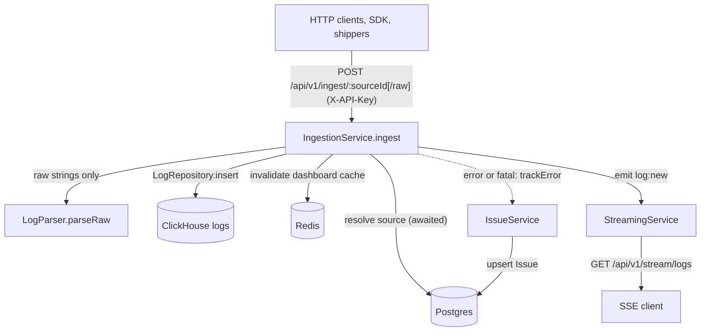
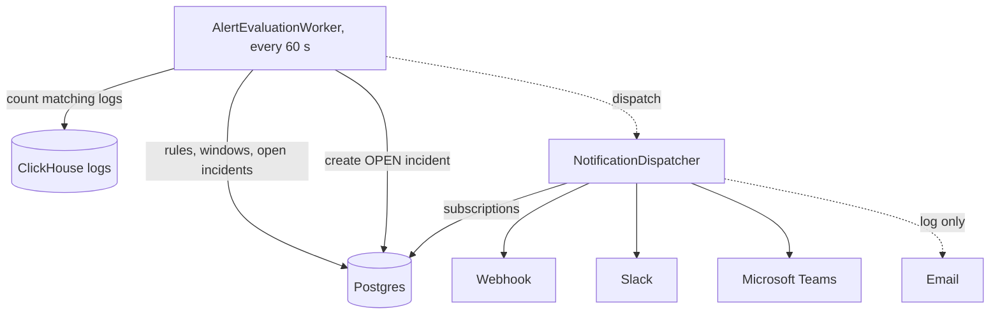
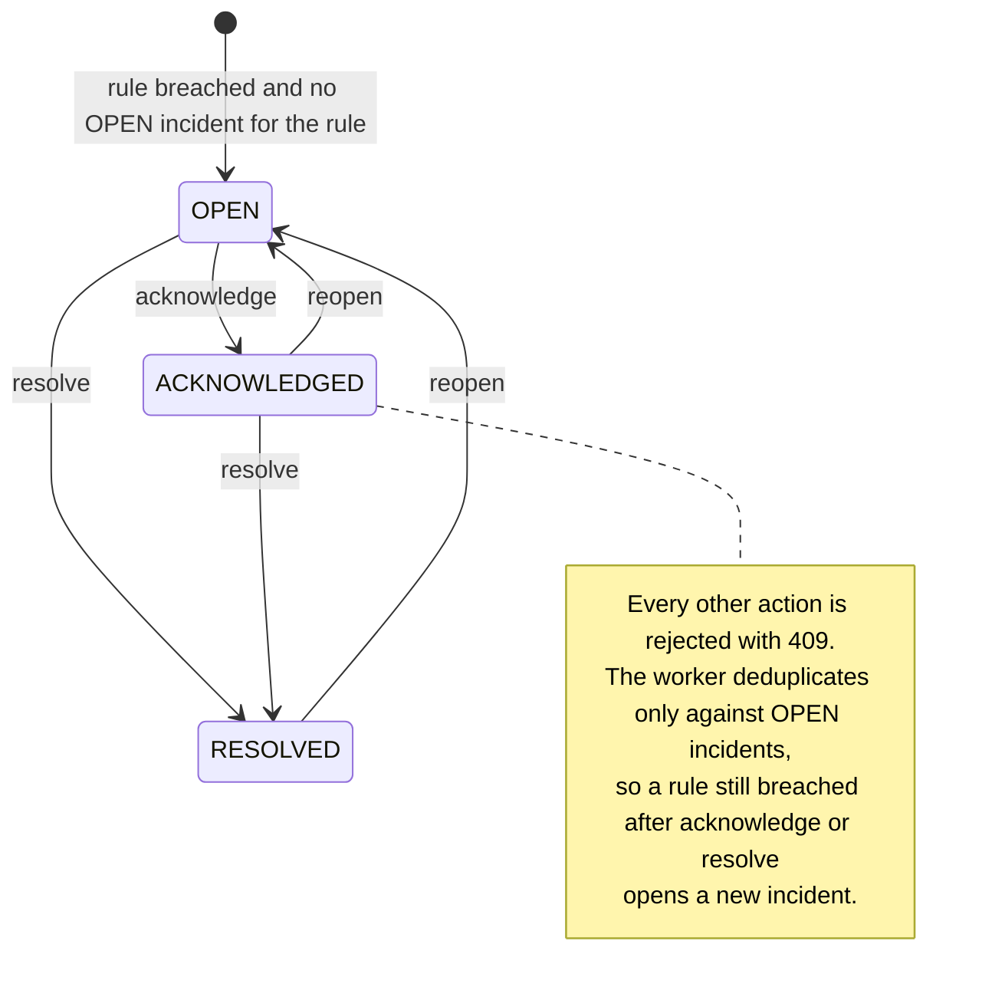

# Architecture

Telerithm is a log analytics backend (Express + TypeScript) plus a Next.js 15 frontend. Logs are parsed at the edge, stored in ClickHouse for query speed, and surfaced through a REST API. Natural-language queries are translated to a structured plan by an OpenAI-compatible LLM, with a deterministic heuristic fallback when no key is configured.

## Repo layout

```
frontend/                 Next.js 15, server components, Tailwind CSS
backend/
  src/
    api/
      openapi.ts          OpenAPI 3 spec served at /openapi.json
      rest/router.ts      REST endpoints
    ingestion/            Single ingestion service, multi-format parser
    parser/               Format detection (JSON, syslog, plain), normalization
    services/
      ai/ai-service.ts    NLQ to filter plan (LLM + heuristic)
      query/              Query plan execution, pattern normalization
      alert/              Alert rules, incident lifecycle, alert-evaluation-worker.ts
      issue/              Error grouping
      ingestion/          Error fingerprinting (fingerprint.ts)
      streaming/          SSE live tail
      team/               Tenancy, sources, invites, RBAC
      notification/       Channels: webhook, slack, msteams, email (log only)
      subscription/       Notification subscriptions
      dashboard/          Overview dashboard
      log-view/           Saved views
    cache/                Redis dashboard cache
    config/               Environment variable parsing (Zod)
    metrics/              Prometheus registry
    validation/           Zod request schemas
    repositories/         ClickHouse + Prisma data access
  clickhouse/             logs table DDL (init.sql) and ClickHouse server config
  prisma/                 Postgres schema (applied with prisma db push, no migrations) and demo seed
  tests/                  Vitest unit and integration tests
packages/sdk-js/          @telerithm/sdk client SDK
packages/cli/             stdin-to-ingest shipping script (logforge-pipe.sh)
deploy/                   Optional fluentd / vector ingestion sidecars
```

## Data flow

Two independent paths write and read the stores: the ingest path, triggered by each request, and the alert path, driven by a timer. In both diagrams, dashed edges are fire-and-forget calls or channels that send nothing.

The ingest path looks up the source in Postgres (the API key in `authenticateApiKey`, then the source id in `IngestionService.ingest`) and waits for it, writes each batch to ClickHouse and then triggers its side effects:



The alert path runs on its own timer and reads what the ingest path stored:



The Email branch only serves subscriptions that already exist: creating or switching to an `EMAIL` subscription is rejected until a mail transport exists. Alerting does not run on ingest: `AlertEvaluationWorker` polls every 60 seconds. Postgres also holds teams, users, sources, saved views and the other tenancy state; Redis also backs the health check.

## Ingestion pipeline

`POST /api/v1/ingest/:sourceId` is the main ingest entrypoint; `POST /api/v1/ingest/:sourceId/raw` takes a `text/plain` body, splits it into lines and passes them to the same `IngestionService.ingest` as raw strings (other content types get 415). The main route's body is a JSON object whose `logs` field holds an array, or the bare array itself, which is what Fluentd and Vector post ([api.md](api.md#ingest-request-bodies) has the details). Each entry is either:

- A structured `LogEntry` object (`timestamp`, `level`, `service`, `host`, `message`, `fields`).
- A raw string, parsed by `LogParser` based on `payload.format` or auto-detection.

The `IngestionService` (`backend/src/ingestion/ingestion-service.ts`) resolves the source by ID, looks up its team, normalises each entry (default timestamp, default level, default host), and writes the batch to ClickHouse via `LogRepository`. After the insert, it calls `IssueService` for each error or fatal entry without waiting for the result; `IssueService` fingerprints the message and assigns it to an existing group or creates a new one.

Source types are defined in `backend/src/types/domain.ts`:

```ts
export type SourceType =
  | "HTTP"
  | "SYSLOG_UDP"
  | "SYSLOG_TCP"
  | "FILEBEAT"
  | "DOCKER"
  | "CLOUDWATCH";
```

The source type is a label stored on the source; it does not change how logs arrive. `deploy/fluentd` and `deploy/vector` ship reference forwarder configs (plus `deploy/docker-compose.logging.yml` to run the sidecar) that collect Docker container logs and post them to the HTTP endpoint. Syslog, Filebeat and CloudWatch need a forwarder you configure yourself that posts batches in the `logs` envelope or as a bare array; see [configuration.md](configuration.md#ingestion-sources).

## NLQ pipeline

The natural-language query path is the central AI integration. `POST /api/v1/query/natural` forwards to `QueryService.explainNaturalQuery`, which delegates to `AIService.translateQuery` (`backend/src/services/ai/ai-service.ts`).

```
NL query ──► AIService.translateQuery
                │
                ├─ if OPENAI_API_KEY set:
                │     OpenAI SDK ──► chat.completions.create
                │       (json_object response_format,
                │        temperature 0.1, retry 2x with backoff)
                │     ──► Zod-validated structured plan
                │
                └─ else:
                      heuristic translator
                      (regex level/service detection,
                       stopword-filtered text terms)

returns NLQTranslation:
  { explanation, filtersApplied[], inferredTimeRange?, textTerms[], warnings[] }
```

Key design choices:

- **OpenAI SDK, not OpenAI cloud.** `OPENAI_BASE_URL` lets you point at any OpenAI-compatible server (Ollama, llama.cpp, vLLM). See [LOCAL_LLM.md](../LOCAL_LLM.md).
- **No SQL generation.** The LLM produces a structured filter plan, not SQL. The query layer compiles it. This keeps the LLM blast radius small (no injection, no schema leakage) and lets the frontend show editable filter chips.
- **Facet hints, not free text.** When a log search runs with `queryType: "natural"`, known service, host and level values from the current scope are passed to the LLM as ground truth, and unknown values go into `textTerms` instead of becoming bogus filters. `POST /query/natural` translates without these hints.
- **Retry + fallback.** Transient errors (timeout, 429, 5xx) retry with exponential backoff. After exhaustion, or immediately for any other LLM error, the heuristic translator runs so the UI still gets a usable plan.
- **Schema-validated.** The LLM response is validated with Zod (`nlqResponseSchema`). Validation failures count as parse errors and trigger fallback.

## Storage

- **ClickHouse** holds log rows. Append-only, columnar, partitioned by day. Search and histogram queries hit ClickHouse directly. Log rows expire after 30 days through the table TTL in `backend/clickhouse/init.sql`. That file only runs on an empty ClickHouse data directory; change the TTL on a running instance with `ALTER TABLE logs MODIFY TTL toDateTime(timestamp) + INTERVAL <n> DAY`. The per-source `retentionDays` value is stored but not enforced.
- **Postgres** holds tenancy state: teams, users, sources, alert rules, incidents, saved views, invites, escalation policies (schema only, see Alerting). Managed by Prisma.
- **Redis** caches dashboard-overview summaries (`CacheService`, invalidated on ingest) and backs the `/api/v1/health` check. It does not hold SSE subscriber state: `StreamingService` is an in-process `EventEmitter`, so subscriber state does not survive past a single backend process.

## Alerting

`AlertEvaluationWorker` runs inside the backend process: once at startup, then every 60 seconds (one evaluation loop per backend process). It loads the enabled rules, counts matching log rows in ClickHouse for each, and on threshold breach creates an `Incident` and dispatches notifications via `NotificationDispatcher`. Rules are read from Postgres; the API can list, create, edit, delete, mute and unmute them, and the Alerts page offers create, edit, an enabled toggle and delete for roles that may write (a VIEWER sees the list only). `condition` is one of `GREATER_THAN`, `LESS_THAN`, `EQUALS` or `CHANGES_BY`, and `query` is the substring that is counted; `ANOMALY_DETECTED` and a `queryType` other than the default are rejected with 400. The demo seed still inserts one example rule. Maintenance windows suppress rule evaluation entirely (no incidents, no notifications). `POST /api/v1/subscriptions/:id/test` is the exception: it dispatches a synthetic test notification straight through `NotificationDispatcher` without checking maintenance windows at all, so an operator can verify a channel is wired up even while a window is active. Escalation policies are planned: the `EscalationPolicy`/`EscalationStep` schema ships, but nothing evaluates or advances the steps yet; the worker fires notifications once per incident.

How a rule is evaluated:

- The rule `query` is not a query language: it is a case-insensitive substring match on the log message (`message ILIKE '%<query>%'`) within the rule window (`windowMinutes`). The rule's `queryType` is ignored.
- Evaluated conditions are `GREATER_THAN`, `LESS_THAN`, `EQUALS`, and `CHANGES_BY` (the absolute difference to the previous window of the same length). `ANOMALY_DETECTED` is a reserved value in the schema with no detector behind it: the worker skips such a rule before it counts anything and logs one warning per rule and process, so it never fires.
- Muted rules (`muteUntil` in the future) and teams inside an active maintenance window are skipped.
- Deduplication checks only for an `OPEN` incident of the rule. A rule that is still breached after its incident was acknowledged or resolved opens a new incident on the next run.
- New incidents always get severity `MEDIUM`.

Incidents move between three states. The acknowledge, resolve and reopen actions (`POST /api/v1/alerts/incidents/:id/acknowledge`, `/resolve`, `/reopen`) check the current state first: acknowledge applies to `OPEN`, resolve to `OPEN` or `ACKNOWLEDGED`, reopen to `RESOLVED` or `ACKNOWLEDGED`. Any other combination answers 409 and writes nothing; an accepted action writes an `IncidentEvent` to the timeline. The state diagram shows the transitions.



## Rate limiting

Every request first passes through a global limiter mounted in `backend/src/app.ts` (200 requests / minute per client IP, before routing), then, for a few route groups, a second and stricter one defined in `backend/src/api/rest/router.ts`. Nothing is exempt from the global limiter: it also covers `GET /metrics`, `GET /api/v1/health` (including the Docker healthcheck's poll of that route every 30s, see `docker-compose.prod.yml`), and `GET /openapi.json`. See [docs/api.md](api.md) for the full limit table and env vars.

Every limiter is an in-memory, per-process counter (`express-rate-limit`'s default `MemoryStore`), not Redis-backed, even though `ioredis` is a dependency and connects at startup (see Storage above): `rate-limit-redis` is not a dependency, the pre-existing global/ingest/auth limiters were already in-memory, and this deployment runs a single backend replica, so a shared store would add a dependency without changing behavior today. That's correct for the current single-instance deployment, but each instance would track its own counters if the backend were ever run behind a load balancer with more than one replica, effectively multiplying the limit by the instance count.

## Streaming

`/api/v1/stream/logs` is an SSE endpoint. The `IngestionService` emits events on accepted batches; `StreamingService` filters per subscriber by team, the `sourceId`, `service`, `host` and `level` query parameters (exact match), plus `query`, a case-insensitive substring match on message, service and host, then writes server-sent events to the connected client.
