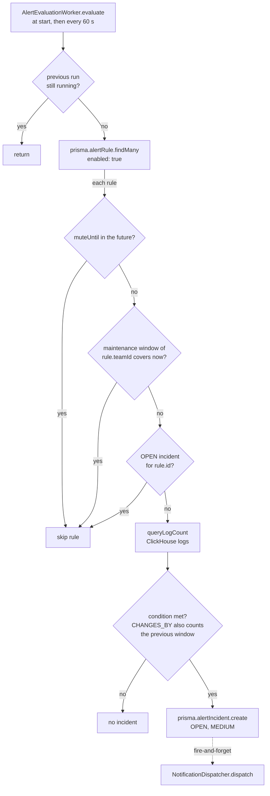

# Alert evaluation and incident lifecycle

[../architecture.md](../architecture.md)'s "Alerting" section is the authoritative description of the evaluation rules (substring match, the four evaluated conditions, mute and maintenance skips, deduplication against `OPEN` only, severity `MEDIUM`) and carries the incident state diagram. This doc does not restate them; it records how the worker, the routes, the schema, the seeds and the notification side depend on each other.

## Responsibility

- `AlertEvaluationWorker` (`backend/src/services/alert/alert-evaluation-worker.ts`) owns turning enabled `AlertRule` rows into `AlertIncident` rows and handing each new incident to `NotificationDispatcher`. `AlertService` (`backend/src/services/alert/alert-service.ts`) and the incident routes in `router.ts` own the human transitions.
- Not owned here: rule authoring (no route exists, see below), notification delivery (see [notification-delivery-trust-boundary.md](notification-delivery-trust-boundary.md)), and escalation (schema only, per architecture.md).

## Entry points

- `server.ts` builds the worker with no argument (`backend/src/server.ts:35#"const alertWorker = new AlertEvaluationWorker();"`), so the interval is the constructor default of 60 seconds (`backend/src/services/alert/alert-evaluation-worker.ts:14#"constructor(private readonly intervalMs = 60_000) {}"`); no env var changes it. `start()` runs in the `listen` callback (`backend/src/server.ts:39#"alertWorker.start();"`), evaluates once immediately and then on the timer (`backend/src/services/alert/alert-evaluation-worker.ts:19-21#"this.evaluate();"`); shutdown calls `stop()` (`backend/src/server.ts:47#"alertWorker.stop();"`).
- Routes: `GET /alerts/rules` (`backend/src/api/rest/router.ts:800#"/alerts/rules"`) and `GET /alerts/incidents` (`backend/src/api/rest/router.ts:816#"/alerts/incidents"`) for members; rule mute and unmute (`backend/src/api/rest/router.ts:845#"/alerts/rules/:id/mute"`, `backend/src/api/rest/router.ts:864#"/alerts/rules/:id/unmute"`), maintenance-window create and delete, and incident acknowledge, resolve and reopen through `writeRoute`; the incident timeline for members.

## One evaluation run

The flowchart shows the gates one run applies to each rule, in code order.

- **Concurrency.** The `running` flag (`backend/src/services/alert/alert-evaluation-worker.ts:33#"if (this.running) return;"`) only stops overlapping runs inside one process. Deduplication is a `findFirst` for an `OPEN` incident of the rule (`backend/src/services/alert/alert-evaluation-worker.ts:85-88#"if (openIncident) return;"`) followed later by a separate `create`, with no lock and no unique constraint on `AlertIncident` (`backend/prisma/schema.prisma:100#"model AlertIncident {"`). It holds only while one backend process evaluates.
- **Skips are not made up.** A muted rule, or a rule whose team has a window covering the current time (`backend/src/services/alert/alert-evaluation-worker.ts:72#"const activeWindow = await prisma.maintenanceWindow.findFirst({"`), is simply not evaluated. Skipped runs are not repeated later. Each run counts only the `windowMinutes` before it (`backend/src/services/alert/alert-evaluation-worker.ts:91#"const windowStart"`), and `CHANGES_BY` also reads the window before that (`backend/src/services/alert/alert-evaluation-worker.ts:108#"const prevStart"`). The first run after a mute or window ends comes up to one 60 s interval later, or later still while a previous run is in progress, and counts the `windowMinutes` before that run. A breach late in the suppressed period can still open an incident on that run; older matching logs (twice that span for `CHANGES_BY`) are never counted. Muting does not touch existing incidents. `maintenanceWindowSchema` does not check that `endsAt` is after `startsAt` (`backend/src/validation/schemas.ts:173-177#"endsAt: z.string().datetime(),"`); such a window never covers the current time and suppresses nothing.
- **Matching.** The rule text goes into a bound parameter wrapped in `%` (`backend/src/services/alert/alert-evaluation-worker.ts:153#"%${query}%"`), so it cannot change the SQL, but a `%` or `_` inside the rule text is an `ILIKE` wildcard, not a literal. The count query places `team_id` first, see [clickhouse-tenant-row-scoping.md](clickhouse-tenant-row-scoping.md). `CHANGES_BY` triggers on `>=` the threshold (`backend/src/services/alert/alert-evaluation-worker.ts:111#"triggered = delta >= rule.threshold;"`), `GREATER_THAN` on `>` (`backend/src/services/alert/alert-evaluation-worker.ts:99#"triggered = currentCount > rule.threshold;"`).
- **The incident row.** It is created with severity `MEDIUM` (`backend/src/services/alert/alert-evaluation-worker.ts:123#"severity:"`) and a message that embeds the rule text, count, threshold and condition (`backend/src/services/alert/alert-evaluation-worker.ts:124#"triggered: count="`). No `IncidentEvent` is written at creation; a timeline starts with the first human action. Dispatch is not awaited (`backend/src/services/alert/alert-evaluation-worker.ts:130-141#".catch((err) => log.error("`): the incident exists whether or not any notification is delivered, and no delivery state is stored.
- **Metrics.** `telerithm_alert_evaluations_total` (`backend/src/metrics/index.ts:42#"telerithm_alert_evaluations_total"`) is incremented once per rule per run with `status` `ok` or `error` (`backend/src/services/alert/alert-evaluation-worker.ts:43#"alertEvaluationsTotal.inc("`); a rule skipped by mute, window or deduplication returns normally and counts as `ok`. A failure to load the rule list is only logged. `telerithm_alert_incidents_created_total` (`backend/src/metrics/index.ts:49#"telerithm_alert_incidents_created_total"`) counts worker-created incidents.

## Where rules come from

No route creates, edits, enables, disables or deletes a rule. The only `prisma.alertRule` writes in `backend/src` are the mute and unmute updates (`backend/src/api/rest/router.ts:850#"prisma.alertRule.update({"`, `backend/src/api/rest/router.ts:868#"prisma.alertRule.update({"`) and the demo seed.

The demo seed exists twice: `backend/src/seed.ts`, compiled to `dist/seed.js` and run by the container on every start (`backend/entrypoint.sh:8#"node dist/seed.js"`), and `backend/prisma/seed.ts`, run by `npm run db:seed` (`backend/package.json:18#"tsx prisma/seed.ts"`) and by `npx prisma db seed` through the `prisma.seed` key (`backend/package.json:20-21#"tsx prisma/seed.ts"`). Both skip in production unless `SEED_DEMO_DATA=true` (`backend/src/seed.ts:8#"process.env.SEED_DEMO_DATA"`). Both create the rule "Spike in payment errors" whose `query` is SQL text (`backend/src/seed.ts:57#"SELECT count() FROM logs WHERE level ="`, `backend/prisma/seed.ts:58#"SELECT count() FROM logs WHERE level ="`); the worker matches it as a substring of the log message, so it counts only messages that contain that literal text. Both also create an `OPEN` incident with severity `HIGH` for that rule (`backend/src/seed.ts:65-69#"severity:"`, `backend/prisma/seed.ts:66-70#"severity:"`). The seed does not dispatch it, and through deduplication it keeps the worker from opening another incident for the rule until someone acknowledges or resolves it.

The rule's `queryType` (`backend/prisma/schema.prisma:87#"@default(SQL)"`) is only mapped for display by `listRules` (`backend/src/services/alert/alert-service.ts:16#"r.queryType ==="`); the worker does not read it.

## Severity and subscriptions

`findForIncident` selects a subscription when its severity list is empty or contains the incident's severity (`backend/src/services/subscription/subscription-service.ts:74#"has: severity"`). Worker incidents are always `MEDIUM`, so a subscription whose list is non-empty and omits `MEDIUM` never receives one. Of the incidents that are dispatched, only the test route's synthetic `LOW` incident has another severity. The test route is described in [notification-delivery-trust-boundary.md](notification-delivery-trust-boundary.md).

## Team scoping

`AlertIncident` has no `teamId`; its team is the rule's team. Every read and write derives it through the relation: `listIncidents` filters on `rule: { teamId }` and returns the 20 newest (`backend/src/services/alert/alert-service.ts:25#"where: { rule: { teamId } },"`, `backend/src/services/alert/alert-service.ts:27#"take: 20,"`), the route loader reads `rule.teamId` (`backend/src/api/rest/router.ts:1156-1159#"incident?.rule.teamId"`), and each transition first runs `assertIncidentInTeam` (`backend/src/services/alert/alert-service.ts:44#"private async assertIncidentInTeam("`). Deleting a team cascades to its rules (`backend/prisma/schema.prisma:95#"onDelete: Cascade"`), a rule to its incidents (`backend/prisma/schema.prisma:107#"onDelete: Cascade"`), and an incident to its events (`backend/prisma/schema.prisma:189#"onDelete: Cascade"`).

## Human transitions

The acknowledge, resolve and reopen routes resolve the team from the incident (`backend/src/api/rest/router.ts:1161#"const incidentTeam = teamFromResource(loadIncidentTeamId"`) and run behind `writeRoute`, so a `VIEWER` gets 403 (see [api-authz-and-team-scoping.md](api-authz-and-team-scoping.md)). The optional `comment` is limited to 1000 characters (`backend/src/validation/schemas.ts:134#"comment: z.string().max(1000).optional(),"`), but a body that fails the schema is not rejected: the comment is dropped and the action proceeds (`backend/src/api/rest/router.ts:1169#"parsed.success ? parsed.data.comment : undefined"`). Each action writes the status and an `IncidentEvent` in one transaction (`backend/src/services/alert/alert-service.ts:56#"await prisma.$transaction(["`). `COMMENTED` exists in `IncidentAction` (`backend/prisma/schema.prisma:183#"COMMENTED"`), but no code writes it. A reopen sets the incident back to `OPEN`, which again blocks new incidents for its rule.

Mute takes `durationMinutes` from 1 to 43200 (`backend/src/validation/schemas.ts:170#"durationMinutes: z.number().int().min(1).max(43200),"`) and stores `muteUntil` as the current time plus that duration (`backend/src/api/rest/router.ts:848#"input.durationMinutes * 60_000"`); unmute clears it.

## Invariants enforced here

- [ClickHouse tenant row-scoping](clickhouse-tenant-row-scoping.md): `queryLogCount` is the one `logs` reader outside `LogRepository` and places `team_id` first by hand.
- [Notification delivery trust boundary](notification-delivery-trust-boundary.md): what happens to an incident after `dispatch`.
