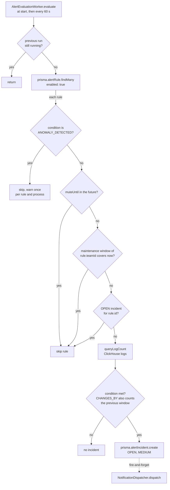

# Alert evaluation and incident lifecycle

[../architecture.md](../architecture.md)'s "Alerting" section is the authoritative description of the evaluation rules (substring match, the four evaluated conditions, mute and maintenance skips, deduplication against `OPEN` only, severity `MEDIUM`) and carries the incident state diagram. This doc does not restate them; it records how the worker, the routes, the schema, the seeds and the notification side depend on each other.

## Responsibility

- `AlertEvaluationWorker` (`backend/src/services/alert/alert-evaluation-worker.ts`) owns turning enabled `AlertRule` rows into `AlertIncident` rows and handing each new incident to `NotificationDispatcher`. `AlertService` (`backend/src/services/alert/alert-service.ts`) and the incident routes in `router.ts` own the human transitions.
- Rule authoring (create, edit, enable or disable, delete) is owned by `AlertService` and three `writeRoute` routes, see "Where rules come from". Not owned here: notification delivery (see [notification-delivery-trust-boundary.md](notification-delivery-trust-boundary.md)), and escalation (schema only, per architecture.md).

## Entry points

- `server.ts` builds the worker with no argument (`backend/src/server.ts:37#"const alertWorker = new AlertEvaluationWorker();"`), so the interval is the constructor default of 60 seconds (`backend/src/services/alert/alert-evaluation-worker.ts:24#"constructor(private readonly intervalMs = 60_000) {}"`); no env var changes it. `start()` runs in the `listen` callback (`backend/src/server.ts:41#"alertWorker.start();"`), evaluates once immediately and then on the timer (`backend/src/services/alert/alert-evaluation-worker.ts:29-31#"this.evaluate();"`); shutdown calls `stop()` (`backend/src/server.ts:49#"alertWorker.stop();"`).
- Routes: `GET /alerts/rules` (`backend/src/api/rest/router.ts:930#"/alerts/rules"`) and `GET /alerts/incidents` (`backend/src/api/rest/router.ts:946#"/alerts/incidents"`) for members; rule create, edit and delete (`backend/src/api/rest/router.ts:1015#"/alerts/rules", teamFromBody(createAlertRuleSchema)"`, `backend/src/api/rest/router.ts:1022#"/alerts/rules/:id","`, `backend/src/api/rest/router.ts:1037#"/alerts/rules/:id","`), rule mute and unmute (`backend/src/api/rest/router.ts:975#"/alerts/rules/:id/mute"`, `backend/src/api/rest/router.ts:994#"/alerts/rules/:id/unmute"`), maintenance-window create and delete, and incident acknowledge, resolve and reopen through `writeRoute`; the incident timeline for members.

## One evaluation run

The flowchart shows the gates one run applies to each rule, in code order.

- **Reserved condition.** `ANOMALY_DETECTED` is an `AlertCondition` value with no detector behind it. The worker checks for it before any lookup (`backend/src/services/alert/alert-evaluation-worker.ts:78#"rule.condition ==="`), logs one warning per rule id and process (`backend/src/services/alert/alert-evaluation-worker.ts:80#"warnedUnsupported.add"`) and returns, so the rule never counts logs or opens an incident, and the run still counts as `ok`. The enum value stays in the schema because removing it takes a migration, and that migration fails on a database that still has such a row.
- **Concurrency.** The `running` flag (`backend/src/services/alert/alert-evaluation-worker.ts:43#"if (this.running) return;"`) only stops overlapping runs inside one process. Deduplication is a `findFirst` for an `OPEN` incident of the rule (`backend/src/services/alert/alert-evaluation-worker.ts:109-112#"if (openIncident) return;"`) followed later by a separate `create`, with no lock and no unique constraint on `AlertIncident` (`backend/prisma/schema.prisma:100#"model AlertIncident {"`). It holds only while one backend process evaluates.
- **Skips are not made up.** A muted rule, or a rule whose team has a window covering the current time (`backend/src/services/alert/alert-evaluation-worker.ts:96#"const activeWindow = await prisma.maintenanceWindow.findFirst({"`), is simply not evaluated. Skipped runs are not repeated later. Each run counts only the `windowMinutes` before it (`backend/src/services/alert/alert-evaluation-worker.ts:115#"const windowStart"`), and `CHANGES_BY` also reads the window before that (`backend/src/services/alert/alert-evaluation-worker.ts:132#"const prevStart"`). The first run after a mute or window ends comes up to one 60 s interval later, or later still while a previous run is in progress, and counts the `windowMinutes` before that run. A breach late in the suppressed period can still open an incident on that run; older matching logs (twice that span for `CHANGES_BY`) are never counted. Muting does not touch existing incidents. `maintenanceWindowSchema` does not check that `endsAt` is after `startsAt` (`backend/src/validation/schemas.ts:270-274#"endsAt: dateTimeSchema,"`); such a window never covers the current time and suppresses nothing.
- **Matching.** The rule text goes into a bound parameter wrapped in `%` (`backend/src/services/alert/alert-evaluation-worker.ts:180#"%${query}%"`), so it cannot change the SQL, but a `%` or `_` inside the rule text is an `ILIKE` wildcard, not a literal. The count query places `team_id` first, see [clickhouse-tenant-row-scoping.md](clickhouse-tenant-row-scoping.md), and takes the window bounds as `YYYY-MM-DD HH:MM:SS.mmm` text (`backend/src/services/alert/alert-evaluation-worker.ts:178#"toClickHouseTimestamp(from)"`): ClickHouse rejects the trailing `Z` of an ISO string for a `DateTime64` parameter, which made every evaluation fail before this (the `T` is replaced too, to match the format `LogRepository` uses). `CHANGES_BY` triggers on `>=` the threshold (`backend/src/services/alert/alert-evaluation-worker.ts:135#"triggered = delta >= rule.threshold;"`), `GREATER_THAN` on `>` (`backend/src/services/alert/alert-evaluation-worker.ts:123#"triggered = currentCount > rule.threshold;"`).
- **The incident row.** It is created with severity `MEDIUM` (`backend/src/services/alert/alert-evaluation-worker.ts:147#"severity:"`) and a message that embeds the rule text, count, threshold and condition (`backend/src/services/alert/alert-evaluation-worker.ts:148#"triggered: count="`). No `IncidentEvent` is written at creation; a timeline starts with the first human action. Dispatch is not awaited (`backend/src/services/alert/alert-evaluation-worker.ts:154-165#".catch((err) => log.error("`): the incident exists whether or not any notification is delivered, and no delivery state is stored.
- **Metrics.** `telerithm_alert_evaluations_total` (`backend/src/metrics/index.ts:42#"telerithm_alert_evaluations_total"`) is incremented once per rule per run with `status` `ok` or `error` (`backend/src/services/alert/alert-evaluation-worker.ts:53#"alertEvaluationsTotal.inc("`); a rule skipped by mute, window or deduplication returns normally and counts as `ok`. A failure to load the rule list is only logged. `telerithm_alert_incidents_created_total` (`backend/src/metrics/index.ts:49#"telerithm_alert_incidents_created_total"`) counts worker-created incidents.

## Where rules come from

Three routes author rules, all through `writeRoute` (a VIEWER gets 403 before any handler runs, and so does a non-member of the body's team; a non-member of the team that owns a stored rule gets the same 404 as for an unknown id, see [api-authz-and-team-scoping.md](api-authz-and-team-scoping.md)): `POST /alerts/rules` takes its team from the body (`teamFromBody`), `PUT /alerts/rules/:id` and `DELETE /alerts/rules/:id` take it from the stored rule (`teamFromResource` with `loadRuleTeamId`, 404 for an unknown id). `AlertService.updateRule` and the rule delete in `deleteRule` repeat the team in the write itself (`backend/src/services/alert/alert-service.ts:77#"where: { id: ruleId, teamId },"`, `backend/src/services/alert/alert-service.ts:108#"prisma.alertRule.delete({ where: { id: ruleId, teamId } }),"`), so a rule of another team matches nothing and answers 404. The body schemas (`backend/src/validation/schemas.ts:86#"export const createAlertRuleSchema = z.object({"`) refuse what the worker cannot act on: `condition` is one of `GREATER_THAN`, `LESS_THAN`, `EQUALS`, `CHANGES_BY` (`backend/src/validation/schemas.ts:73#"const alertRuleConditionSchema"`), so `ANOMALY_DETECTED`, which the worker skips, is a 400; on create `queryType` may only be `sql` (or absent), because `query` is matched as a substring whatever the type says; `windowMinutes` is 1 to 1440 and `threshold` a non-negative integer. `PUT` is a partial update (any subset of the fields, at least one), and the team is never read from its body. `PUT` does not accept `queryType` (an unknown key is dropped), and `name`, `description` and `query` are capped at 200, 1000 and 1000 characters. `DELETE` is a hard delete in one transaction: `deleteRule` first deletes every subscription that targets the rule (whichever team owns it, so no `teamId` filter), then the rule, scoped by `teamId`; an unknown or other-team id makes the rule delete fail and rolls the subscription delete back, and the rule's incidents go with it through the schema's cascade. The foreign key also cascades (`backend/prisma/schema.prisma:215#"references: [id], onDelete: Cascade)"`), so a subscription that a concurrent request creates between the two deletes goes with the rule instead of being set to NULL; a subscription without a rule matches every rule of the team (`backend/src/services/subscription/subscription-service.ts:79#"OR: [{ ruleId }, { ruleId: null }],"`). The explicit delete stays as a second layer for a database whose schema predates the cascade. A rule that already carries `ANOMALY_DETECTED` stays listed, and the UI asks for one of the four conditions before it can be saved again. The other `prisma.alertRule` writes in `backend/src` are the mute and unmute updates (`backend/src/api/rest/router.ts:980#"prisma.alertRule.update({"`, `backend/src/api/rest/router.ts:998#"prisma.alertRule.update({"`) and the demo seed.

The demo seed is one dataset in `backend/src/seed.ts`, compiled to `dist/seed.js` and run by the container on every start, after the migration step (`backend/entrypoint.sh:11#"node dist/seed.js"`). `backend/prisma/seed.ts` is only a re-import of it (`backend/prisma/seed.ts:4#"../src/seed.js"`), kept for `npm run db:seed` (`backend/package.json:21#"tsx prisma/seed.ts"`) and `npx prisma db seed` through the `prisma.seed` key (`backend/package.json:23-24#"tsx prisma/seed.ts"`). A second full copy used to live there and had drifted: it set a `plan` the `Team` model does not have, so it failed after creating the demo user, and the next run then skipped as "already exists". The seed skips in production unless `SEED_DEMO_DATA=true` (`backend/src/seed.ts:8#"process.env.SEED_DEMO_DATA"`). It creates the rule "Spike in payment errors" whose `query` is the plain text `Payment failed` (`backend/src/seed.ts:59#"Payment failed"`), the message `scripts/seed-demo-logs.ts` writes for failed payments; the worker matches it as a substring of the log message, so the rule fires when more than 10 such messages fall inside the last `windowMinutes` (5 by default) before a run: the older rows that script writes never count, a burst of fresh ones does. The seed also creates an `OPEN` incident with severity `HIGH` for that rule (`backend/src/seed.ts:71#"severity:"`). It does not dispatch it, and through deduplication it keeps the worker from opening another incident for the rule until someone acknowledges or resolves it.

The rule's `queryType` (`backend/prisma/schema.prisma:87#"@default(SQL)"`) is only mapped for display by `toAlertRule`, which `listRules` and the write methods return (`backend/src/services/alert/alert-service.ts:34#"r.queryType ==="`); the worker does not read it.

## Severity and subscriptions

`findForIncident` selects a subscription when its severity list is empty or contains the incident's severity (`backend/src/services/subscription/subscription-service.ts:82#"has: severity"`). Worker incidents are always `MEDIUM`, so a subscription whose list is non-empty and omits `MEDIUM` never receives one. Of the incidents that are dispatched, only the test route's synthetic `LOW` incident has another severity. The test route is described in [notification-delivery-trust-boundary.md](notification-delivery-trust-boundary.md).

## Team scoping

`AlertIncident` has no `teamId`; its team is the rule's team. Every read and write derives it through the relation: `listIncidents` filters on `rule: { teamId }` and returns the 20 newest (`backend/src/services/alert/alert-service.ts:119#"where: { rule: { teamId } },"`, `backend/src/services/alert/alert-service.ts:121#"take: 20,"`), the route loader reads `rule.teamId` (`backend/src/api/rest/router.ts:1373-1376#"incident?.rule.teamId"`), and each transition first runs `assertIncidentInTeam` (`backend/src/services/alert/alert-service.ts:139#"private async assertIncidentInTeam("`), which also returns the current status. Deleting a team cascades to its rules (`backend/prisma/schema.prisma:95#"onDelete: Cascade"`), a rule to its incidents (`backend/prisma/schema.prisma:107#"onDelete: Cascade"`) and to the subscriptions that target it (`backend/prisma/schema.prisma:215#"references: [id], onDelete: Cascade)"`), and an incident to its events (`backend/prisma/schema.prisma:189#"onDelete: Cascade"`).

## Human transitions

The acknowledge, resolve and reopen routes resolve the team from the incident (`backend/src/api/rest/router.ts:1378#"const incidentTeam = teamFromResource(loadIncidentTeamId"`) and run behind `writeRoute`, so a `VIEWER` gets 403 (see [api-authz-and-team-scoping.md](api-authz-and-team-scoping.md)). The optional `comment` is limited to 1000 characters (`backend/src/validation/schemas.ts:220#"comment: z.string().max(1000).optional(),"`), but a body that fails the schema is not rejected: the comment is dropped and the action proceeds (`backend/src/api/rest/router.ts:1388#"parsed.success ? parsed.data.comment : undefined"`). Each action first reads the incident's status and applies only the transitions in `INCIDENT_TRANSITIONS` (`backend/src/services/alert/alert-service.ts:16#"export const INCIDENT_TRANSITIONS = {"`): acknowledge from `OPEN`, resolve from `OPEN` or `ACKNOWLEDGED`, reopen from `RESOLVED` or `ACKNOWLEDGED`. Any other combination throws `ConflictError` (`backend/src/services/alert/alert-service.ts:167#"throw new ConflictError("`), which the three routes turn into 409 through `handleServiceError` (`backend/src/api/rest/router.ts:1361#"error instanceof ConflictError"`), with no status change and no event. An allowed action writes the status and an `IncidentEvent` in one transaction (`backend/src/services/alert/alert-service.ts:172#"await prisma.$transaction(["`), and the update repeats the status it read in its `where` clause, so a request that lost a race matches no row (`P2025`, `backend/src/services/alert/alert-service.ts:184#"P2025"`) and also answers 409 instead of overwriting the newer state. `COMMENTED` exists in `IncidentAction` (`backend/prisma/schema.prisma:183#"COMMENTED"`), but no code writes it. A reopen sets the incident back to `OPEN`, which again blocks new incidents for its rule. Acknowledge refuses a `RESOLVED` incident, so a resolved incident only comes back through reopen, and reopen refuses an incident that is already `OPEN`.

Mute takes `durationMinutes` from 1 to 43200 (`backend/src/validation/schemas.ts:267#"durationMinutes: intSchema.min(1).max(43200),"`) and stores `muteUntil` as the current time plus that duration (`backend/src/api/rest/router.ts:978#"input.durationMinutes * 60_000"`); unmute clears it.

## Invariants enforced here

- [ClickHouse tenant row-scoping](clickhouse-tenant-row-scoping.md): `queryLogCount` is the one `logs` reader outside `LogRepository` and places `team_id` first by hand.
- [Notification delivery trust boundary](notification-delivery-trust-boundary.md): what happens to an incident after `dispatch`.
