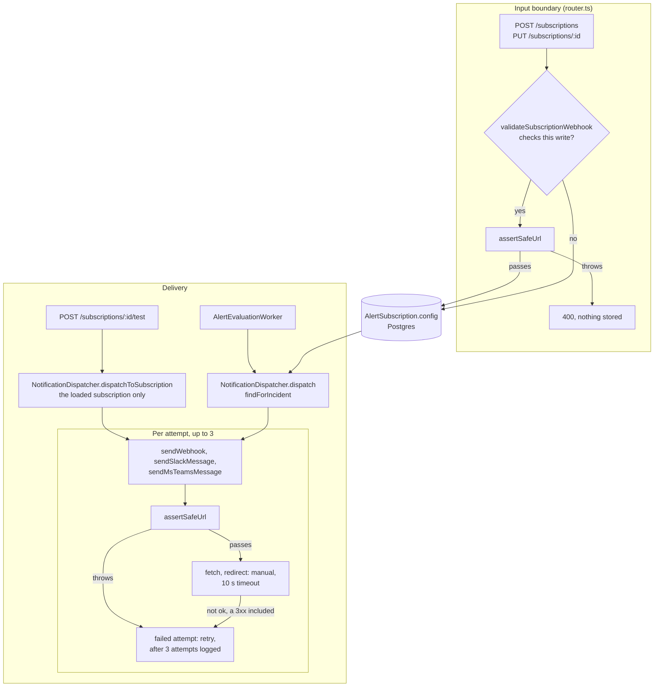

# Notification delivery trust boundary

[../configuration.md](../configuration.md)'s "Notification channels" section is the user-facing reference (channels, `config` keys, payload, signature header, retries). This doc covers what that section does not: which check is binding, where it sits in each code path, and what a change must keep.

## The invariant

Every outbound HTTP request to a subscriber-configured URL is preceded, in the same function and on the exact URL string passed to `fetch`, by `assertSafeUrl` (`backend/src/services/notification/url-guard.ts:268#"export async function assertSafeUrl("`), and is sent with `redirect: "manual"`.

There are three such requests, and they are the only `fetch` calls in `backend/src`:

- `WEBHOOK`: `sendWebhook` checks `url` (`backend/src/services/notification/channels/webhook.ts:35#"await assertSafeUrl(url);"`) and fetches it (`backend/src/services/notification/channels/webhook.ts:41#"redirect:"`).
- `SLACK`: there is no Slack channel module; `sendSlackMessage` lives in the dispatcher (`backend/src/services/notification/notification-dispatcher.ts:157#"async function sendSlackMessage("`), checks `webhook_url` (`backend/src/services/notification/notification-dispatcher.ts:187#"await assertSafeUrl(webhookUrl);"`) and fetches it (`backend/src/services/notification/notification-dispatcher.ts:193#"redirect:"`).
- `MSTEAMS`: `sendMsTeamsMessage` checks `webhook_url` (`backend/src/services/notification/channels/msteams.ts:61#"await assertSafeUrl(webhookUrl);"`) and fetches it (`backend/src/services/notification/channels/msteams.ts:67#"redirect:"`).

`EMAIL` makes no outbound request, and the create and update schemas no longer accept it (see Input boundary), so only subscriptions stored before that can reach it: `sendEmail` writes one log line with the recipient and subject (`backend/src/services/notification/channels/email.ts:15-20#"Email notification (SMTP not configured, logging only)"`). Its recipient is `config.email`, or else the subscriber's own address (`backend/src/services/notification/notification-dispatcher.ts:107#"to: config.email ?? subscription.user.email"`). `config.email` is not validated anywhere, since the subscription `config` is a free-form record; the fallback is the account's registered address, which signup validates as an email (`backend/src/validation/schemas.ts:7#"email: z.string().email(),"`).

## Where it's enforced

The flowchart shows the two places a URL is checked, from the subscription write to the delivery attempt.

**Input boundary.** `validateSubscriptionWebhook` (`backend/src/api/rest/router.ts:1425#"async function validateSubscriptionWebhook("`) maps the channel to its URL key (`url` for `WEBHOOK`, `webhook_url` for `SLACK` and `MSTEAMS`, `backend/src/api/rest/router.ts:1431-1432#"webhook_url"`) and runs `assertSafeUrl` on that value, answering 400 with the guard's message on rejection. `POST /subscriptions` requires a channel (`createSubscriptionSchema`, `backend/src/validation/schemas.ts:201#"export const createSubscriptionSchema = z.object({"`, required `channel` at `backend/src/validation/schemas.ts:204#"channel: subscriptionChannelSchema,"`), and that channel schema (also used, optional, by the update schema) refuses `EMAIL` with a 400 until a mail transport exists (`backend/src/validation/schemas.ts:199#"message: EMAIL_CHANNEL_UNSUPPORTED_MESSAGE"`), and `config` is a free-form record there (`backend/src/validation/schemas.ts:205#"config: z.record(z.unknown()),"`). This check does not run on every write, so the delivery-time check below is the binding one.

**Delivery.** The dispatcher reads the same keys from the stored `config` (`backend/src/services/notification/notification-dispatcher.ts:89#"const url = config.url;"`, `backend/src/services/notification/notification-dispatcher.ts:120#"const webhookUrl = config.webhook_url;"`, `backend/src/services/notification/notification-dispatcher.ts:126#"const teamsUrl = config.webhook_url;"`) and hands them to the senders, which run the check on every attempt. A guard rejection is thrown inside the retry loop, so it counts as a failed attempt like a network error: up to three attempts with 1 s and 2 s waits, then the error is logged (`backend/src/services/notification/notification-dispatcher.ts:145#"if (attempt === MAX_RETRIES) throw err;"`). Each subscriber's failure is caught on its own (`backend/src/services/notification/notification-dispatcher.ts:52#".catch((err) => {"`, `backend/src/services/notification/notification-dispatcher.ts:60#"await Promise.allSettled(tasks);"`), so `dispatch` resolves even when every delivery failed. With `redirect: "manual"` a 3xx response is not followed; it is not `ok`, so the sender throws and the attempt fails.

**The guard itself.** `assertSafeUrl` fails closed on every branch:

- An unparseable URL, a scheme other than `http:` or `https:` (`backend/src/services/notification/url-guard.ts:276-277#"Unsupported webhook scheme"`), or an empty host throws.
- When `WEBHOOK_HOST_ALLOWLIST` is set (`backend/src/services/notification/url-guard.ts:28#"process.env.WEBHOOK_HOST_ALLOWLIST"`), a host not in it throws (`backend/src/services/notification/url-guard.ts:285-286#"!allowlist.includes(host)"`). The allow-list is an extra condition, not an exemption: an allowed host still goes through the address check below. It is read from `process.env` on each call, not through the startup config schema.
- An IP-literal host (IPv6 brackets stripped first, `backend/src/services/notification/url-guard.ts:294#"const bareHost ="`) is range-checked directly (`backend/src/services/notification/url-guard.ts:299#"if (isIP(bareHost) !== 0) {"`). A name is resolved with `lookup(..., { all: true })` (`backend/src/services/notification/url-guard.ts:308#"addresses = await lookup(bareHost, { all: true });"`); a failed or empty resolution throws, and the URL is rejected if any resolved address is blocked (`backend/src/services/notification/url-guard.ts:317-320#"Webhook host resolves to a blocked address range"`).
- `isBlockedAddress` (`backend/src/services/notification/url-guard.ts:107#"function isBlockedAddress("`) treats anything that is not a parseable IP as blocked (`backend/src/services/notification/url-guard.ts:109#"if (family === 0) return true;"`). It blocks the IPv4 private, loopback, link-local and metadata (169.254.0.0/16), CGNAT, `0.0.0.0/8` and multicast or reserved ranges, and the IPv6 unspecified, loopback, link-local, unique-local and multicast ranges. IPv4 addresses embedded in IPv6 (mapped, NAT64 `64:ff9b::/96`, 6to4, Teredo, IPv4-compatible) are decoded and re-checked; additional /96 NAT64 prefixes come from `WEBHOOK_NAT64_ADDITIONAL_PREFIXES` (`backend/src/services/notification/url-guard.ts:72#"function envNat64Prefixes("`).

**Who can set a target.** Any member of the team, `VIEWER` included, can create a subscription: `POST /subscriptions` checks membership through `requireTeamRole`, not the write gate (subscriptions are outside `writeRoute`, see [api-authz-and-team-scoping.md](api-authz-and-team-scoping.md)). `PUT` and `DELETE` match the row by id and the caller's user id (`backend/src/services/subscription/subscription-service.ts:58#"where: { id, userId },"`), and `POST /subscriptions/:id/test` loads the subscription the same way (`backend/src/api/rest/router.ts:1529#"where: { id: String(req.params.id), userId },"`).

**What leaves the system.** The webhook body carries `incidentId`, `ruleId`, `severity`, `status`, `message` and `createdAt` (`backend/src/services/notification/notification-dispatcher.ts:94-99#"createdAt: incident.createdAt,"`). The Teams Adaptive Card carries the severity, message, incident id, status and time, but not the rule id (`backend/src/services/notification/channels/msteams.ts:37-51#"value: incident.createdAt"`); Slack gets the same fields as Block Kit text. For an incident created by the alert worker, `message` embeds the rule's `query` text verbatim (`backend/src/services/alert/alert-evaluation-worker.ts:148#"triggered: count="`). Only `WEBHOOK` signs its body: with a `secret` in `config` (`backend/src/services/notification/notification-dispatcher.ts:101#"{ secret: config.secret }"`), `X-Telerithm-Signature` is the HMAC-SHA256 of the exact serialised body (`backend/src/services/notification/channels/webhook.ts:28-30#"X-Telerithm-Signature"`). Slack and Teams requests carry no signature.

**The test route.** `POST /subscriptions/:id/test` (`backend/src/api/rest/router.ts:1520-1523#"notificationTestLimiter,"`) builds a synthetic `LOW` incident from that subscription's rule (the placeholder `test-rule` when it has none) and team and sends it with `dispatchToSubscription` (`backend/src/api/rest/router.ts:1541#"await dispatcher.dispatchToSubscription(subscription, {"`; the incident's `severity` is on `backend/src/api/rest/router.ts:1545#"severity:"`). That method (`backend/src/services/notification/notification-dispatcher.ts:70#"async dispatchToSubscription("`) hands the one subscription the route loaded for the caller to the same `sendWithRetry` as `dispatch`, so it does not run `findForIncident`: no teammate's subscription of the same rule and team is notified, and the caller's own subscription is sent even when it is disabled or its `severities` exclude `LOW`. The channel modules and their `assertSafeUrl` check are the same ones, so the delivery-time guard applies unchanged. Unlike `dispatch`, a failure after the third attempt is rethrown, and the route answers `500 { error: <message> }` instead of `200 { ok: true }`; `200` means the channel accepted the message. It is the only route with its own per-user limiter (`backend/src/api/rest/router.ts:151#"const notificationTestLimiter = rateLimit({"`), 5 requests per 5 minutes by default (`backend/src/config/index.ts:185-190#"notificationTestRateLimitMax: z.coerce.number().int().positive().default(5),"`).

## What breaks it

- A new outbound channel, or a new `fetch` in an existing one, that does not call `assertSafeUrl` on the exact URL it fetches, immediately before the request. The router check cannot replace it: it does not run on every write, and a stored value outlives the DNS answer it was checked against.
- Dropping `redirect: "manual"` from any of the three requests: `fetch` would follow a 3xx to a host the guard never saw.
- Renaming a channel's URL key on one side only. `validateSubscriptionWebhook` and the dispatcher hold the `url` and `webhook_url` mapping separately; a mismatch makes the input check look at the wrong key while delivery uses another.
- Adding a real SMTP transport to `sendEmail`, or lifting the `EMAIL` rejection in the subscription schemas, without validating `config.email`: today the address only reaches a log line.
- Checking the URL once and fetching a different string (a normalised, templated or redirected form): the guard's result only holds for the string it was given.
