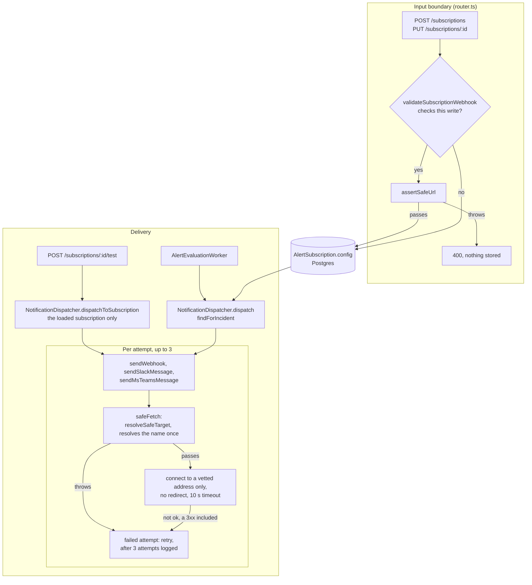

# Notification delivery trust boundary

[../configuration.md](../configuration.md)'s "Notification channels" section is the user-facing reference (channels, `config` keys, payload, signature header, retries). This doc covers what that section does not: which check is binding, where it sits in each code path, and what a change must keep.

## The invariant

Every outbound HTTP request to a subscriber-configured URL is made by `safeFetch` (`backend/src/services/notification/safe-fetch.ts:130#"export async function safeFetch("`), which in its first step vets the exact URL string with `resolveSafeTarget` (`backend/src/services/notification/safe-fetch.ts:135#"const target = await resolveSafeTarget("`; the guard function is `backend/src/services/notification/url-guard.ts:300#"export async function resolveSafeTarget("`) and then connects only to the addresses that call vetted. The name is resolved once, inside the guard; the socket's connect-time `lookup` answers from that vetted set and never asks DNS (`backend/src/services/notification/safe-fetch.ts:109#"lookup: pinnedLookup(addresses),"`). The URL keeps its host name, so the Host header, the TLS SNI name and the certificate check stay on the original name; only the address that is dialled is pinned. No request follows a redirect.

There are three such requests, and they are the only outbound HTTP requests in `backend/src`; none of them calls the global `fetch`:

- `WEBHOOK`: `sendWebhook` hands `url` to `safeFetch` (`backend/src/services/notification/channels/webhook.ts:37#"const res = await safeFetch(url,"`).
- `SLACK`: there is no Slack channel module; `sendSlackMessage` lives in the dispatcher (`backend/src/services/notification/notification-dispatcher.ts:158#"async function sendSlackMessage("`) and hands `webhook_url` to `safeFetch` (`backend/src/services/notification/notification-dispatcher.ts:189#"const res = await safeFetch(webhookUrl,"`).
- `MSTEAMS`: `sendMsTeamsMessage` hands `webhook_url` to `safeFetch` (`backend/src/services/notification/channels/msteams.ts:63#"const res = await safeFetch(webhookUrl,"`).

`safeFetch` is built on `node:http` and `node:https`, not on the global `fetch`, so the pinned lookup does not depend on a dispatcher version that matches the Node runtime, and neither client follows a redirect: a 3xx is returned as a response that is not `ok` (`backend/src/services/notification/safe-fetch.ts:116#"resolve({ ok: status >= 200"`), the sender throws, and the attempt fails. Each request gets a fresh agent (`backend/src/services/notification/safe-fetch.ts:104#"agent: false,"`), so no pooled socket is reused, and the timeout is 10 s unless the caller passes another (`backend/src/services/notification/safe-fetch.ts:105#"signal: AbortSignal.timeout("`). A subscriber-supplied `Host`, `Content-Length`, `Transfer-Encoding`, `Connection`, `Expect` or `Upgrade` header is dropped (`backend/src/services/notification/safe-fetch.ts:51#"const MANAGED_HEADERS = new Set("`), as `fetch` treats them as forbidden. The proxy environment variables are not consulted, so no proxy sits between the pinned address and the target.

`EMAIL` makes no outbound request, and the create and update schemas no longer accept it (see Input boundary), so only subscriptions stored before that can reach it: `sendEmail` writes one log line with the recipient and subject (`backend/src/services/notification/channels/email.ts:15-20#"Email notification (SMTP not configured, logging only)"`). Its recipient is `config.email`, or else the subscriber's own address (`backend/src/services/notification/notification-dispatcher.ts:108#"to: config.email ?? subscription.user.email"`). `config.email` is not validated anywhere, since the subscription `config` is a free-form record; the fallback is the account's registered address, which signup validates as an email (`backend/src/validation/schemas.ts:40#"email: z.string().email(),"`).

## Where it's enforced

The flowchart shows the two places a URL is checked, from the subscription write to the delivery attempt. Only the delivery attempt also decides which address is dialled.

**Input boundary.** `validateSubscriptionWebhook` (`backend/src/api/rest/router.ts:1457#"async function validateSubscriptionWebhook("`) maps the channel to its URL key (`url` for `WEBHOOK`, `webhook_url` for `SLACK` and `MSTEAMS`, `backend/src/api/rest/router.ts:1463-1464#"webhook_url"`) and runs `assertSafeUrl` on that value, answering 400 with the guard's message on rejection. `POST /subscriptions` requires a channel (`createSubscriptionSchema`, `backend/src/validation/schemas.ts:234#"export const createSubscriptionSchema = z.object({"`, required `channel` at `backend/src/validation/schemas.ts:237#"channel: subscriptionChannelSchema,"`), and that channel schema (also used, optional, by the update schema) refuses `EMAIL` with a 400 until a mail transport exists (`backend/src/validation/schemas.ts:232#"message: EMAIL_CHANNEL_UNSUPPORTED_MESSAGE"`), and `config` is a free-form record there (`backend/src/validation/schemas.ts:238#"config: z.record(z.string(), z.unknown()),"`). This check does not run on every write, so the delivery-time check below is the binding one.

**Delivery.** The dispatcher reads the same keys from the stored `config` (`backend/src/services/notification/notification-dispatcher.ts:90#"const url = config.url;"`, `backend/src/services/notification/notification-dispatcher.ts:121#"const webhookUrl = config.webhook_url;"`, `backend/src/services/notification/notification-dispatcher.ts:127#"const teamsUrl = config.webhook_url;"`) and hands them to the senders, which go through `safeFetch` on every attempt, so every attempt resolves and vets the name afresh and dials only what that attempt vetted. A guard rejection is thrown inside the retry loop, so it counts as a failed attempt like a network error: up to three attempts with 1 s and 2 s waits, then the error is logged (`backend/src/services/notification/notification-dispatcher.ts:146#"if (attempt === MAX_RETRIES) throw err;"`). Each subscriber's failure is caught on its own (`backend/src/services/notification/notification-dispatcher.ts:53#".catch((err) => {"`, `backend/src/services/notification/notification-dispatcher.ts:61#"await Promise.allSettled(tasks);"`), so `dispatch` resolves even when every delivery failed. A 3xx response is not followed; it is not `ok`, so the sender throws and the attempt fails.

**The guard itself.** `resolveSafeTarget` fails closed on every branch (`assertSafeUrl`, `backend/src/services/notification/url-guard.ts:369#"export async function assertSafeUrl("`, is the same check without the result and is what the input boundary calls):

- An unparseable URL, a scheme other than `http:` or `https:` (`backend/src/services/notification/url-guard.ts:308-309#"Unsupported webhook scheme"`), or an empty host throws.
- When `WEBHOOK_HOST_ALLOWLIST` is set (`backend/src/services/notification/url-guard.ts:32#"process.env.WEBHOOK_HOST_ALLOWLIST"`), a host not in it throws (`backend/src/services/notification/url-guard.ts:318#"!allowlist.includes(host)"`). The allow-list is an extra condition, not an exemption: an allowed host still goes through the address check below. It is read from `process.env` on each call, not through the startup config schema.
- An IP-literal host (IPv6 brackets stripped first, `backend/src/services/notification/url-guard.ts:326#"const bareHost ="`) is range-checked directly (`backend/src/services/notification/url-guard.ts:331#"if (isIP(bareHost) !== 0) {"`) and is its own vetted address, so there is no DNS step. A name is resolved once with `lookup(..., { all: true })` (`backend/src/services/notification/url-guard.ts:340#"resolved = await deps.lookup(bareHost);"`); a failed or empty resolution throws, and the URL is rejected if any resolved address is blocked (`backend/src/services/notification/url-guard.ts:349-353#"Webhook host resolves to a blocked address range"`). The de-duplicated answer set is the vetted set handed back to `safeFetch` (`backend/src/services/notification/url-guard.ts:359#"addresses: [...new Set("`); the socket may use any address in it, in the resolver's order or by happy-eyeballs, and no address outside it.
- `isBlockedAddress` (`backend/src/services/notification/url-guard.ts:111#"function isBlockedAddress("`) treats anything that is not a parseable IP as blocked (`backend/src/services/notification/url-guard.ts:113#"if (family === 0) return true;"`). It blocks the IPv4 private, loopback, link-local and metadata (169.254.0.0/16), CGNAT, `0.0.0.0/8` and multicast or reserved ranges, and the IPv6 unspecified, loopback, link-local, unique-local and multicast ranges. IPv4 addresses embedded in IPv6 (mapped, NAT64 `64:ff9b::/96`, 6to4, Teredo, IPv4-compatible) are decoded and re-checked; additional /96 NAT64 prefixes come from `WEBHOOK_NAT64_ADDITIONAL_PREFIXES` (`backend/src/services/notification/url-guard.ts:76#"function envNat64Prefixes("`).

**Who can set a target.** Any member of the team, `VIEWER` included, can create a subscription: `POST /subscriptions` checks membership through `requireTeamRole`, not the write gate (subscriptions are outside `writeRoute`, see [api-authz-and-team-scoping.md](api-authz-and-team-scoping.md)). `PUT` and `DELETE` match the row by id and the caller's user id (`backend/src/services/subscription/subscription-service.ts:58#"where: { id, userId },"`), and `POST /subscriptions/:id/test` loads the subscription the same way (`backend/src/api/rest/router.ts:1561#"where: { id: String(req.params.id), userId },"`).

**What leaves the system.** The webhook body carries `incidentId`, `ruleId`, `severity`, `status`, `message` and `createdAt` (`backend/src/services/notification/notification-dispatcher.ts:95-100#"createdAt: incident.createdAt,"`). The Teams Adaptive Card carries the severity, message, incident id, status and time, but not the rule id (`backend/src/services/notification/channels/msteams.ts:38-52#"value: incident.createdAt"`); Slack gets the same fields as Block Kit text. For an incident created by the alert worker, `message` embeds the rule's `query` text verbatim (`backend/src/services/alert/alert-evaluation-worker.ts:148#"triggered: count="`). Only `WEBHOOK` signs its body: with a `secret` in `config` (`backend/src/services/notification/notification-dispatcher.ts:102#"{ secret: config.secret }"`), `X-Telerithm-Signature` is the HMAC-SHA256 of the exact serialised body (`backend/src/services/notification/channels/webhook.ts:29-31#"X-Telerithm-Signature"`). Slack and Teams requests carry no signature.

**The test route.** `POST /subscriptions/:id/test` (`backend/src/api/rest/router.ts:1552-1555#"notificationTestLimiter,"`) builds a synthetic `LOW` incident from that subscription's rule (the placeholder `test-rule` when it has none) and team and sends it with `dispatchToSubscription` (`backend/src/api/rest/router.ts:1573#"await dispatcher.dispatchToSubscription(subscription, {"`; the incident's `severity` is on `backend/src/api/rest/router.ts:1577#"severity:"`). That method (`backend/src/services/notification/notification-dispatcher.ts:71#"async dispatchToSubscription("`) hands the one subscription the route loaded for the caller to the same `sendWithRetry` as `dispatch`, so it does not run `findForIncident`: no teammate's subscription of the same rule and team is notified, and the caller's own subscription is sent even when it is disabled or its `severities` exclude `LOW`. The channel modules and their `safeFetch` call are the same ones, so the delivery-time guard and the address pinning apply unchanged. Unlike `dispatch`, a failure after the third attempt is rethrown, and the route answers `500` instead of `200 { ok: true }`. The route maps a failure three ways, on the error class. A `ChannelConfigError` (`backend/src/services/notification/channels/errors.ts:24#"export class ChannelConfigError extends Error {"`), which every guard refusal (`assertSafeUrl` or `resolveSafeTarget`) and the three "URL not configured" errors in the dispatcher throw, describes the caller's own configuration, so its message is returned in `{ error: <message> }` (`backend/src/api/rest/router.ts:1584#"if (error instanceof ChannelConfigError) {"`). The webhook, Slack and Teams senders throw `ChannelHttpError` for a non-2xx answer (`backend/src/services/notification/channels/errors.ts:7#"export class ChannelHttpError extends Error {"`), which carries the remote status and status text; the route logs those with `log.warn` and answers the generic `{ error: "The channel rejected the test notification" }` (`backend/src/api/rest/router.ts:1593#"if (error instanceof ChannelHttpError) {"`). Every other failure (a refused connection, a timeout, a TLS certificate that does not match the URL's host name; there is no second resolution at send time to fail, and a name the guard itself cannot resolve is a guard refusal and keeps its message) describes the remote host or the network path to it, so the route logs it with `log.warn` and answers the generic `{ error: "The channel could not be reached" }` (`backend/src/api/rest/router.ts:1614#"The channel could not be reached"`). The route therefore does not report a caller-chosen host's HTTP status, status text or network error text back to the caller; those details exist only in the server log. It still distinguishes "reached but rejected" from "not reached", and its response time differs by failure mode (a refused connection answers within seconds, a timeout after the retries). `200` means no attempt failed; the `EMAIL` channel only logs and an unsupported channel is skipped, so for those nothing is sent. It is the only route with its own per-user limiter (`backend/src/api/rest/router.ts:152#"const notificationTestLimiter = rateLimit({"`), 5 requests per 5 minutes by default (`backend/src/config/index.ts:202-207#"notificationTestRateLimitMax: coercedIntSchema.positive().default(5),"`).

## What breaks it

- A new outbound channel, or a new request in an existing one, that does not go through `safeFetch` on the exact URL it sends to: a plain `fetch`, `http.request` or a client library resolves the name itself, so a host whose DNS answer changes between the guard's lookup and the connect (DNS rebinding) steers the delivery to an address the guard never saw, and the global `fetch` and most libraries also follow redirects. The router check cannot replace it: it does not run on every write, and a stored value outlives the DNS answer it was checked against.
- Replacing or dropping the pinned `lookup` (`backend/src/services/notification/safe-fetch.ts:109#"lookup: pinnedLookup(addresses),"`), or letting it fall back to DNS: the socket then resolves the name again and the vetted set no longer binds the connection. Likewise, a change that dials the vetted address by putting it in the URL host instead of the lookup moves the Host header, the TLS SNI name and the certificate check off the original name.
- Following redirects, in `safeFetch` or by moving a sender to a client that does: a 3xx would lead to a host the guard never saw. `node:http` and `node:https` do not follow one, which is what keeps this closed.
- Sending through an HTTP proxy or an egress agent that resolves the name on its own: the pinned address is then only the proxy's. `safeFetch` ignores the proxy environment variables; a deployment that forces all egress through a proxy is outside this guard.
- Renaming a channel's URL key on one side only. `validateSubscriptionWebhook` and the dispatcher hold the `url` and `webhook_url` mapping separately; a mismatch makes the input check look at the wrong key while delivery uses another.
- Adding a real SMTP transport to `sendEmail`, or lifting the `EMAIL` rejection in the subscription schemas, without validating `config.email`: today the address only reaches a log line.
- Residual: the pin holds per attempt. Each retry resolves and vets the name again (up to three attempts), so a host can answer private on one attempt and public on another; an attempt that sees the private answer is refused, never sent. The range check itself has the gaps its own comments name (Teredo compression variants not decoded), which are unchanged here.
- Checking the URL once and fetching a different string (a normalised, templated or redirected form): the guard's result only holds for the string it was given.
